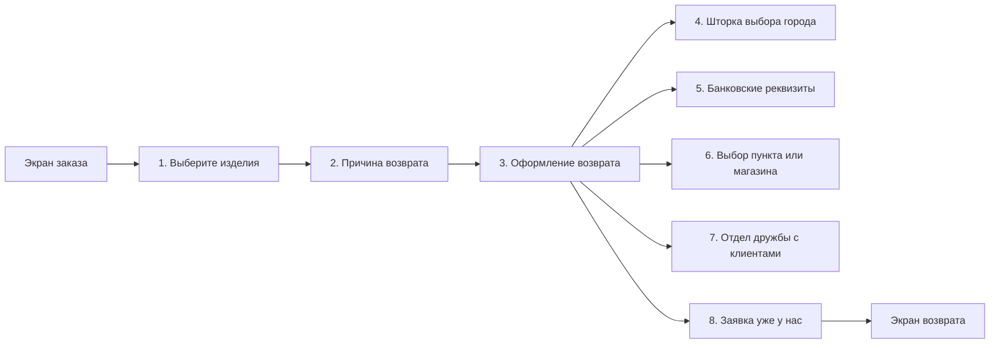

# Элементы экранов оформления возврата: мобильное приложение, MVP

Сценарии, вызовы методов и логика — в SRS МП MVP (US 1.1–1.5). Здесь — состав экранов и ограничения полей. Тексты на макетах — пример: описания способов, тексты «Возврат средств» и подсказки к причинам приходят с сервера.

Макеты: https://www.figma.com/design/u5Fe5N4lypCdqgZn6533F2/%F0%9F%93%B1-06.-Profile--Redesign-?node-id=5547-145537&t=qoHbaQAbTlMNGNZX-4 (номера макетов ниже — по выгрузке «v2 Создание возврата / MVP»). Экран созданного возврата и экран «Возврат заказов» — в спецификации экранов.

Порядок экранов:

## Экран 1. Выберите изделия

Макеты: `2`, `3`. US 1.2, шаги 1–5.



#|
|| **Элемент** | **Свойства** | **Действие** ||
|| **1.1. Кнопка «Назад»** | • Тип: кнопка-иконка
• Отображается: всегда | Закрыть экран, вернуться на экран заказа ||
|| **1.2. Заголовок** | • Тип: текст
• По умолчанию: «Выберите изделия»
• Если выбрано N ≥ 1 изделий — «Выберите изделия · N» | — ||
|| **1.3. Предупреждение о комплектации** | • Тип: текст
• Отображается: всегда
• По умолчанию: «Пожалуйста, возвращайте изделие в полной комплектации (включая пояса, съемные броши и кофры)» | — ||
|| **1.4. Строка изделия** | • Тип: карточка
• Отображается: для позиций с `items[].can_be_returned = true`; позиции с `false` не отображаются
• Одна строка на изделие: строк столько, сколько `items[].available_return_quantity`
• Кофр или подарок, если он отдельная позиция заказа, — отдельной строкой
• Состав: фото, цена, наименование, артикул, цвет и размер — из ответа метода `GET /получить карточку заказа` | Нажатие на строку переключает чекбокс 1.5 ||
|| **1.5. Чекбокс изделия** | • Тип: чекбокс
• По умолчанию: не отмечен
• Кофр или подарок при выборе основного изделия не отмечается автоматически | Отметить или снять изделие; пересчитать N в 1.2 и состояние 1.7 ||
|| **1.6. Цена** | • Формат: `12 980 ₽`
• Если есть цена до скидки — цена со скидкой красным и цена до скидки зачёркнутой
• Артикул — «Арт. XXXXXX», цвет и размер — «[маркер] Цвет · Размер» | — ||
|| **1.7. Кнопка «Указать причину возврата»** | • Тип: основная кнопка, закреплена внизу
• По умолчанию: неактивна
• Активна, если отмечено хотя бы одно изделие | Запросить справочник причин и открыть экран 2 ||
|#



## Экран 2. Причина возврата

Макеты: `4`, `5`, `6`. US 1.2, шаги 6–12.



#|
|| **Элемент** | **Свойства** | **Действие** ||
|| **2.1. Кнопка «Назад»** | • Тип: кнопка-иконка
• Отображается: всегда | См. открытый вопрос 1 ||
|| **2.2. Заголовок и счётчик** | • Тип: текст
• Заголовок: «Причина возврата»
• Подзаголовок: «Изделие K из N», K — номер текущего изделия, N — число отмеченных на экране 1 | — ||
|| **2.3. Карточка текущего изделия** | • Состав — как 1.4, без чекбокса | — ||
|| **2.4. Поле группы причин** | • Тип: выпадающий список
• Обязательное
• По умолчанию: плейсхолдер «Выберите причину возврата...»
• Для каждого изделия выбирается своя группа | Открыть шторку 2.5 ||
|| **2.5. Шторка групп причин** | • Тип: шторка
• Отображается: после нажатия на 2.4
• Группы — в порядке из справочника (`result.items[].title`) | Нажатие на группу подставляет её в 2.4 и закрывает шторку; свайп вниз закрывает без выбора ||
|| **2.6. Причина** | • Тип: радиокнопка
• Обязательная, если у группы есть причины
• Отображается: после выбора группы, у которой есть причины
• Выбирается одна причина
• Если у группы нет причин, выбор группы считается выбором причины | Зафиксировать причину для текущего изделия; если изделие не последнее — перейти к следующему, «Изделие K из N» ||
|| **2.7. Подсказка к причине** | • Тип: текст под названием причины
• Отображается: если у причины заполнено `description` | — ||
|| **2.8. Кнопка «Выбрать способ возврата»** | • Тип: основная кнопка, закреплена внизу
• По умолчанию: неактивна
• Активна, когда причина выбрана для всех N изделий | Открыть экран 3 ||
|#



Если клиент вернулся на экран 1 и изменил состав изделий, причины выбираются заново для всех отмеченных изделий.

## Экран 3. Оформление возврата

Макеты: `7`, `12`, `14`, `18`, `19`, `20`, `22`, `23`, `24`. US 1.3, US 1.4, US 1.5.

Блоки экрана сверху вниз: способ возврата → данные способа (адрес или точка) → дата возврата → возврат средств или банковские реквизиты → изделия к возврату → итог и кнопка. Состав блоков зависит от выбранного способа:

#|
|| **Блок** | **Курьер** | **Пункт СДЭК, 5Post** | **Магазин 12 STOREEZ** | **Почта России** ||
|| «Адрес возврата» (3.6–3.10) | Да | — | — | — ||
|| «Пункт возврата» / «Магазин 12 STOREEZ» (3.11) | — | Да | Да | — ||
|| Ссылка «Пункты Почты России» (3.12) | — | — | — | Да ||
|| «Дата возврата»: выбор даты и интервала (3.13–3.14) | Да | — | — | — ||
|| «Дата возврата»: «Вернуть до [дата]» (3.15) | — | Да | Да | Да ||
|#



#|
|| **Элемент** | **Свойства** | **Действие** ||
|| **3.1. Кнопка «Назад»** | • Тип: кнопка-иконка
• Отображается: всегда | Вернуться на экран 2. Введённые на экране 3 данные — см. открытый вопрос 2 ||
|| **3.2. Заголовок** | • Тип: текст
• По умолчанию: «Оформление возврата» | — ||
|| **3.3. Поле города** | • Тип: строка с иконкой геопозиции и стрелкой
• Отображается: всегда, в том числе когда способов нет
• По умолчанию: город из заказа (`order_delivery.city_fias`)
• Длинное название обрезается многоточием | Открыть шторку выбора города (экран 4) ||
|| **3.4. Карточки способов возврата** | • Тип: горизонтальная карусель
• Отображается: если для города есть способы
• Способы и порядок — из ответа метода способов возврата для города
• По умолчанию: способ с `is_order_method = true`; если такого нет — первый в списке
• Выбран ровно один способ | Переключить способ. Данные, заполненные для способа, при возврате к нему сохраняются ||
|| **3.5. Описание способа** | • Тип: текст
• Отображается: если для способа задано описание
• Текст — из справочника способов | — ||
|| **3.6. Подсказка «Проверьте актуальный адрес возврата»** | • Тип: текст
• Отображается: курьер, адрес подставлен из заказа | — ||
|| **3.7. Поле «Улица»** | • Тип: поле ввода с подсказками и кнопкой очистки
• Обязательное; отображается для курьера
• По умолчанию: улица из `order_delivery.address`, если способ — способ заказа
• До 100 символов, выбор из подсказок геосервиса
• Ошибка: красный контур, «Укажите улицу» | Ввод запрашивает подсказки адреса; крестик очищает поле ||
|| **3.8. Поле «Дом, корпус»** | • Тип: поле ввода с подсказками
• Обязательное; отображается для курьера
• По умолчанию: из адреса заказа
• До 25 символов
• Ошибка: красный контур, «Укажите дом» | Выбор адреса из подсказок запрашивает данные адреса и почтовый индекс ||
|| **3.9. Поле «Квартира/офис»** | • Тип: поле ввода
• Необязательное; отображается для курьера
• По умолчанию: из адреса заказа
• До 25 символов | — ||
|| **3.10. Поле «Индекс»** | • Тип: поле ввода
• Обязательное, если отображается
• Отображается: курьер, если индекса нет в адресе заказа или геосервис не вернул его по выбранному адресу
• Формат — см. открытый вопрос 3
• Ошибка: красный контур, «Укажите индекс» | — ||
|| **3.11. Блок точки: «Пункт возврата» (СДЭК, 5Post) или «Магазин 12 STOREEZ»** | • Тип: строка со стрелкой
• Обязательный; отображается для СДЭК, 5Post, Магазин 12 STOREEZ
• По умолчанию: точка из заказа, если способ — способ заказа и точка принимает возвраты; иначе «Выберите пункт» / «Выберите магазин»
• Точка выбрана — название, адрес, время работы и «Изменить»
• Ошибка: «Укажите пункт ПВЗ» / «Укажите магазин» | Открыть экран 6 ||
|| **3.12. Ссылка «Пункты Почты России»** | • Тип: текстовая ссылка
• Отображается: Почта России | Открыть карту отделений Почты России по Калининграду и области во внешнем браузере ||
|| **3.13. Даты приезда курьера** | • Тип: горизонтальная карусель карточек
• Отображается: курьер, заполнены улица и дом, сервис логистики вернул даты и интервалы. Пока улица и дом не заполнены — текст «Сначала укажите адрес»
• Даты — из ответа метода дат и интервалов курьера, не позже последнего дня срока возврата `return.request_until_date`; объём — по `ADR-RET-063`. Сегодня последний день срока — даты на 3 дня вперёд после окончания срока, любую можно выбрать
• По умолчанию: выбрана первая дата
• Подпись: «Сегодня», «Завтра», день недели
• Успешный ответ с пустым списком дат и интервалов — вместо карусели текст «К сожалению, нет свободных дат для вызова курьера» и предложение выбрать другой способ возврата
• Сервис логистики вернул ошибку — блок «Дата возврата» скрыт; возврат курьером оформляется без даты и интервала, их с клиентом согласует Отдел дружбы с клиентами (US 1.5)
• При смене адреса дата и интервал сбрасываются и запрашиваются заново | Выбрать другую дату ||
|| **3.14. Интервал** | • Тип: выпадающий список → шторка интервалов (макет `13`)
• Отображается: вместе с 3.13
• По умолчанию: первый интервал выбранной даты
• Интервалы выбранной даты из того же ответа; выбранный отмечен галочкой | Выбрать другой интервал, закрыть шторку ||
|| **3.15. «Вернуть до [дата]»** | • Тип: текст
• Отображается: СДЭК, 5Post, Магазин 12 STOREEZ, Почта России
• Дата — из ответа метода способов возврата для города; пока клиент на экране, не пересчитывается | — ||
|| **3.16. Блок «Возврат средств»** | • Тип: текст
• Отображается: `return.is_bank_data_required = false`
• Текст — `return.refund.message` | — ||
|| **3.17. Текст об Отделе дружбы** | • Тип: текст со ссылкой
• Отображается: вместе с 3.16
• Текст: «Если вам необходимо получить возврат другим способом или на другие реквизиты, пожалуйста, обратитесь в Отдел дружбы с клиентами» | Ссылка открывает шторку «Отдел дружбы с клиентами» (экран 7) ||
|| **3.18. Блок «Банковские реквизиты»** | • Тип: строка со стрелкой
• Обязательный; отображается при `return.is_bank_data_required = true`, тогда 3.16 и 3.17 не отображаются
• По умолчанию: «Укажите банковские реквизиты»
• После заполнения — ФИО получателя, название банка, номер счёта
• Ошибка: «Укажите банковские реквизиты» красным со значком ошибки | Открыть экран 5: пустой или с введёнными в этой заявке данными ||
|| **3.19. «Изделия к возврату · N»** | • Тип: заголовок и список карточек
• Изделия с экрана 1; карточка — как 1.4 и выбранная причина под ней | — ||
|| **3.20. «Итого к возврату»** | • Тип: текст, закреплён внизу
• Сумма к возврату по выбранным изделиям из ответа метода `GET /получить карточку заказа`; сумму по изделию считает сервер
• Формат: `26 750 ₽` | — ||
|| **3.21. «Баллы к возврату»** | • Тип: текст, закреплён внизу
• Отображается: если по выбранным изделиям есть баллы к возврату | — ||
|| **3.22. Кнопка «Подтвердить возврат»** | • Тип: основная кнопка, закреплена внизу
• Всегда активна; обязательные поля проверяются по нажатию (таблица ниже)
• Во время запроса — индикатор загрузки, повторное нажатие недоступно | Создать заявку; при успехе закрыть экран и показать шторку «Заявка уже у нас» (экран 8) ||
|#



Проверка по нажатию «Подтвердить возврат» (макет `24`): незаполненные поля и блоки подсвечиваются все сразу, экран прокручивается к первому из них, заявка не отправляется.

#|
|| **Способ** | **Поле или блок** | **Когда обязательно** | **Подсветка** ||
|| Курьер | 3.7 «Улица» | Всегда | Красный контур, «Укажите улицу» ||
|| Курьер | 3.8 «Дом, корпус» | Всегда | Красный контур, «Укажите дом» ||
|| Курьер | 3.10 «Индекс» | Если поле отображается | Красный контур, «Укажите индекс» ||
|| Курьер | 3.4 способ «Курьер» | Сервис логистики вернул успешный ответ с пустым списком дат и интервалов: курьер недоступен, нужно выбрать другой способ | «К сожалению, нет свободных дат для вызова курьера» ||
|| СДЭК, 5Post | 3.11 «Пункт возврата» | Всегда | «Укажите пункт ПВЗ» ||
|| Магазин 12 STOREEZ | 3.11 «Магазин 12 STOREEZ» | Всегда | «Укажите магазин» ||
|| Любой | 3.18 «Банковские реквизиты» | Если `return.is_bank_data_required = true` | «Укажите банковские реквизиты» красным со значком ошибки ||
|#

### Нет способов возврата для города

Макет `22`. Отображаются 3.1–3.3; блоки 3.4–3.22 не отображаются.



#|
|| **Элемент** | **Свойства** | **Действие** ||
|| **3.23. Иллюстрация и сообщение** | • Отображается: метод способов возврата для города вернул пустой список
• Текст: «К сожалению, для вашего населенного пункта сейчас нет доступных способов оформления возврата. Пожалуйста, свяжитесь с нами — мы поможем оформить возврат вручную.» | — ||
|| **3.24. Кнопка «Написать нам»** | • Тип: второстепенная кнопка | Открыть шторку «Отдел дружбы с клиентами» (экран 7) ||
|#



## Шторка 4. «Выберите город»

Макеты: `8`, `9`. US 1.3, альтернативная последовательность «Сменить город».



#|
|| **Элемент** | **Свойства** | **Действие** ||
|| **4.1. Кнопка «Закрыть»** | • Тип: кнопка-иконка «крестик» | Закрыть шторку; город и способы не меняются ||
|| **4.2. Заголовок** | • По умолчанию: «Выберите город» | — ||
|| **4.3. Поле страны** | • Тип: строка с иконкой и стрелкой
• По умолчанию: страна города возврата; если не определена — предложение выбрать страну | Открыть список стран с поиском по названию; выбор страны загружает её города ||
|| **4.4. Поиск города** | • Тип: поле поиска
• По умолчанию: плейсхолдер «Название города...»
• Поиск по выбранной стране
• Ничего не найдено — сообщение, что по запросу ничего не найдено | Ввод запрашивает города по названию ||
|| **4.5. Город** | • Тип: радиокнопка с подписью региона (область, край, республика)
• Список городов страны или результаты поиска
• По умолчанию: отмечен текущий город возврата | Выбрать город: запросить данные города; если город другой — показать окно 4.6 ||
|| **4.6. Шторка «Смена города»** | • Тип: шторка
• Отображается: город уже был выбран, и выбран другой город. Если город выбирается впервые (в заказе его нет или данные города не получены) — не отображается
• Текст: «При смене города ранее выбранный способ возврата будет сброшен»
• Кнопки: «Продолжить», «Отмена», «крестик» | «Продолжить» — сбросить способ и все данные способов, применить город, запросить способы заново. «Отмена» и «крестик» — оставить данные без изменений ||
|#



## Экран 5. Банковские реквизиты

Макет `11`. US 1.4, альтернативная последовательность «Указать банковские реквизиты». Состав полей — `FR-37`, `ADR-RET-020`; ИНН банка не запрашивается (`C-19`). Реквизиты прошлых возвратов не подставляются.



#|
|| **Элемент** | **Свойства** | **Действие** ||
|| **5.1. Кнопка «Назад»** | • Тип: кнопка-иконка | Вернуться на экран 3 без сохранения изменений ||
|| **5.2. Заголовок** | • По умолчанию: «Банковские реквизиты» | — ||
|| **5.3. «Фамилия получателя»** | • Тип: поле ввода
• Обязательное
• По умолчанию: пусто; предзаполнение — открытый вопрос 4
• До 255 символов, без ссылок и HTML-тегов | — ||
|| **5.4. «Имя получателя»** | • Как 5.3 | — ||
|| **5.5. «Отчество получателя»** | • Как 5.3 | — ||
|| **5.6. «БИК банка»** | • Тип: поле ввода, цифровая клавиатура
• Обязательное
• Ровно 9 символов | — ||
|| **5.7. «Название банка»** | • Тип: поле ввода
• Обязательное
• До 255 символов, без ссылок и HTML-тегов | — ||
|| **5.8. «Номер лицевого счета»** | • Тип: поле ввода, цифровая клавиатура
• Обязательное
• Только цифры; длина — открытый вопрос 5 | — ||
|| **5.9. «Номер банковской карты»** | • Тип: поле ввода, цифровая клавиатура
• Отображается: всегда; обязательное, если номер счёта начинается с «30232810»
• Маска: `0000 0000 0000 0000`; длина — открытый вопрос 6
• Ошибка: красный контур, «Укажите номер банковской карты» | — ||
|| **5.10. Кнопка «Продолжить»** | • Тип: основная кнопка, закреплена внизу
• Состояние — см. открытый вопрос 7
• Счёт начинается с «30232810», карта не заполнена — переход не выполняется, поле 5.9 подсвечивается | Сохранить реквизиты в рамках оформления и вернуться на экран 3, обновить блок 3.18 ||
|#



## Экран 6. Выбор пункта СДЭК, 5Post или магазина

Макеты: `15`, `16`, `17` — пункт выдачи; `25`, `26`, `27` — магазин. US 1.3, альтернативная последовательность «Выбрать пункт СДЭК, 5Post или магазин 12 STOREEZ».



#|
|| **Элемент** | **Свойства** | **Действие** ||
|| **6.1. Кнопка «Назад»** | • Тип: кнопка-иконка | Вернуться на экран 3 без смены точки ||
|| **6.2. Заголовок** | • «Пункт выдачи» для СДЭК и 5Post, «Магазины» для магазина | — ||
|| **6.3. Поиск** | • Тип: поле поиска
• По умолчанию: плейсхолдер «Метро, улица или название...»
• Способ поиска — открытый вопрос 8 | Отфильтровать точки на карте и в списке ||
|| **6.4. Переключатель «На карте / Списком»** | • Тип: табы
• По умолчанию: «На карте» | Переключить вид ||
|| **6.5. Карта** | • Отображается: вкладка «На карте»
• Центр — город возврата
• Только точки, принимающие возвраты, в городе возврата | Перемещение и масштаб ||
|| **6.6. Метка точки** | • Тип: иконка службы или магазина на карте | Открыть шторку 6.10 ||
|| **6.7. Кнопки карты** | • «+», «−», «моё местоположение» | Изменить масштаб; центрировать карту на местоположении клиента ||
|| **6.8. Строка точки** | • Тип: строка списка со стрелкой
• Отображается: вкладка «Списком»
• Название, адрес; длинный адрес обрезается многоточием | Открыть шторку 6.10 ||
|| **6.9. Расстояние до точки** | • Тип: текст в строке 6.8
• Отображается: если известно местоположение клиента
• Формат: «500 м», «1.2 км» | — ||
|| **6.10. Шторка карточки точки** | • Тип: шторка на весь экран с кнопкой «крестик»
• Пункт СДЭК, 5Post: название, «Адрес», «Как добраться», «Время работы», «Телефон»
• Магазин: те же и «Парковка»
• Поля без данных не отображаются
• «Срок доставки» — открытый вопрос 9 | «Крестик» закрывает шторку без выбора; нажатие на иконку телефона — системный звонок ||
|| **6.11. Кнопка «Выбрать пункт выдачи» / «Выбрать магазин»** | • Тип: основная кнопка, закреплена внизу шторки | Выбрать точку, закрыть шторку и экран 6, показать точку в блоке 3.11 ||
|#



## Шторка 7. «Отдел дружбы с клиентами»

Макет `28`. US 1.3 (нет способов), US 1.4 (ссылка в блоке «Возврат средств»).



#|
|| **Элемент** | **Свойства** | **Действие** ||
|| **7.1. Шторка «Отдел дружбы с клиентами»** | • Тип: шторка с кнопкой «крестик»
• Отображается: после нажатия 3.17 или 3.24
• Часы работы отдела: «Мы работаем с 8:00 до 22:00» | «Крестик» закрывает шторку ||
|| **7.2. Кнопка «Позвонить»** | • Тип: кнопка | Системный звонок в Отдел дружбы ||
|| **7.3. Кнопка «Написать»** | • Тип: кнопка | Открыть чат с Отделом дружбы ||
|#



## Шторка 8. «Заявка уже у нас»

Макет `21`. US 1.5, шаги 4–6.



#|
|| **Элемент** | **Свойства** | **Действие** ||
|| **8.1. Шторка подтверждения** | • Тип: шторка поверх экрана заказа с кнопкой «крестик»
• Отображается: заявка создана
• Заголовок: «Заявка уже у нас»
• Текст зависит от способа возврата; для курьера — что с клиентом свяжутся, если курьера на выбранную дату найти не получится | «Крестик» — закрыть шторку и обновить экран заказа ||
|| **8.2. Кнопка «К возврату»** | • Тип: второстепенная кнопка | Открыть экран созданного возврата (US 3) ||
|#



## Открытые вопросы

#|
|| **№** | **Вопрос** | **Где** | **Адресат** ||
|| 1 | Куда ведёт «Назад» на экране причин при «Изделие K из N», K > 1: к предыдущему изделию с сохранённой причиной или на экран выбора изделий? | 2.1 | Дизайн, МП ||
|| 2 | Сохраняются ли данные экрана оформления (способ, адрес, точка, дата, реквизиты), если клиент ушёл на экран причин и вернулся без изменения состава изделий? | 3.1 | PO ||
|| 3 | Проверять ли формат индекса (6 цифр для РФ)? При оформлении заказа в МП индекс только обязателен, формат не проверяется | 3.10 | PO, бэкенд ||
|| 4 | Предзаполнять ли фамилию и имя из заказа, отчество из профиля ЛК? (Комментарий к US 1.4 в SRS) | 5.3–5.5 | PO ||
|| 5 | Проверять ли, что номер счёта содержит ровно 20 цифр? Сейчас сервер проверяет только наличие цифр | 5.8 | PO, бухгалтерия ||
|| 6 | Длина номера карты: ровно 16 цифр, как в текущей проверке МП, или 16–19 цифр? | 5.9 | PO, бэкенд ||
|| 7 | Кнопка «Продолжить» на экране реквизитов неактивна до заполнения обязательных полей или активна всегда с подсветкой незаполненных по нажатию, как «Подтвердить возврат»? На макете `11` кнопка активна при пустом БИК | 5.10 | Дизайн, МП ||
|| 8 | Поиск точек — фильтр уже загруженного списка на устройстве или запрос к серверу? | 6.3 | МП, бэкенд ||
|| 9 | Нужно ли поле «Срок доставки» в карточке пункта при возврате? Есть на макете `17`, в сценарии US 1.3 его нет | 6.10 | PO, дизайн ||
|#
