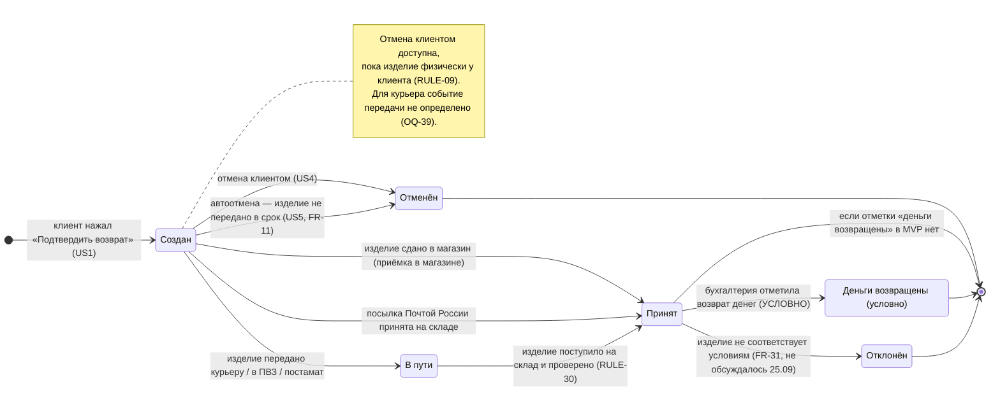

# Статусы заявки на возврат (TO-BE) — диаграмма состояний

**Тип:** диаграмма состояний (state machine).
**Статус:** ГИПОТЕЗА — не утверждено. Состав статусов и переходов — открытый вопрос (BRD `OQ-1`).
**Дата:** 01.10.2026
**Основание:** встреча с RetailCRM 25.09.2026 («усечённая» модель статусов для MVP), BRD (`RULE-09`, `RULE-28`, `RULE-29`, `RULE-30`, `FR-11`, `FR-31`), User Story (US4, US5, US6), [`ADR-RET-015`](<../../../adr/[2026-09-25 13-30] ADR-RET-015-return-tag-without-order-status-change-v1.md>).

> Диаграмма описывает только жизненный цикл **возврата**. Статусы заказа и позиций заказа при возврате не меняются (`RULE-29`, предложение `ADR-RET-015`); в заказе показывается отметка о возврате по связи с позицией возврата.

## Диаграмма

## Статусы

| Статус (рабочее название) | Смысл | Основание | Что не определено |
|---|---|---|---|
| Создан | Заявка создана; клиентское название — «Заявление на возврат создано» | US1, факты `user-story.md` | — |
| В пути | Изделие передано в ТК и едет на склад | Встреча 25.09.2026: «возврат уехал, если там, где это возможно» | Для каких каналов приходит событие; нужен ли статус клиенту (`OQ-1`) |
| Принят | Изделие принято на складе (дистанционные каналы) или в магазине и проверено | Встреча 25.09.2026; `RULE-30` | Разделять ли «поступил на склад» и «проверка пройдена» |
| Деньги возвращены | Финальный статус «возврат выполнен, деньги возвращены» | Встреча 25.09.2026 | **Условно:** появится, только если у бухгалтерии будет кнопка «Деньги возвращены» (обсуждается с Артёмом). Если её нет, финальный статус — «Принят» |
| Отменён | Заявка отменена клиентом или автоматически | US4, US5, `FR-11` | — |
| Отклонён | Изделие не соответствует условиям возврата | `FR-31`, US3 (TODO) | На встрече 25.09 не обсуждался; частичное отклонение части изделий не моделировалось |

## Пути по каналам (гипотеза)

| Канал | Путь |
|---|---|
| Курьер, СДЭК, 5Post | Создан → В пути → Принят → (Деньги возвращены) |
| Розничный магазин | Создан → Принят (приёмка в магазине) → (Деньги возвращены) |
| Почта России | Создан → Принят на складе → (Деньги возвращены) — промежуточных этапов нет |

## Открытые вопросы

- Состав клиентских статусов и их названия (`OQ-1`).
- Будет ли в MVP событие «деньги возвращены» (встреча 25.09.2026). От него зависят US6 «Фиксация выплаты», «Скачать чек» в US3 и отправка CSI-опроса (US10) — см. `user-story.md`, «Требуют подтверждения», п. 20.
- Какое событие считается передачей изделия для курьера (`OQ-39`).
- Статус при частичном отклонении изделий.

## Связанные артефакты

- BRD: `RULE-09`, `RULE-28`, `RULE-29`, `RULE-30`, `FR-11`, `FR-31`, `OQ-1` — [brd.md](../../../brd.md).
- User Story: US1, US3, US4, US5, US6, US10 — [user-story.md](../../../user-story/user-story.md).
- Модель данных: справочник статусов `cms_return_statuses`, история `cms_return_changes` — [ERD](../../erd/to-be/return-entity_erd_merged.md).
- Спецификация экрана: история статусов в `SCR-RET-01` — [screen-spec.md](../../../screen-spec/screen-spec.md).

## Источники

- [Первичная транскрибация встречи с RetailCRM от 25.09.2026](<../../../drafts/transcriptions/[bandicam 2026-09-25 13-30-52-064] Встреча с RCRM.md>), `00:52:12–00:57:43`.
- [Первичная транскрибация встречи от 24.09.2026](<../../../drafts/transcriptions/[bandicam 2026-09-24 15-01-11-768] PJ Возвраты (регулярная встреча по проекта у рамках OKR Q4).md>), `00:05:30–00:10:17`.

## История изменений

| Дата | Изменение |
|---|---|
| 01.10.2026 | Создана как гипотеза по встречам 24.09 и 25.09.2026 |
