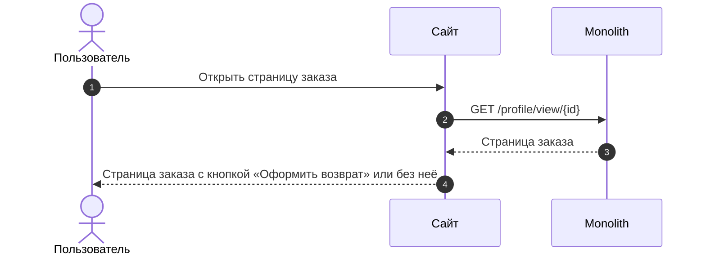
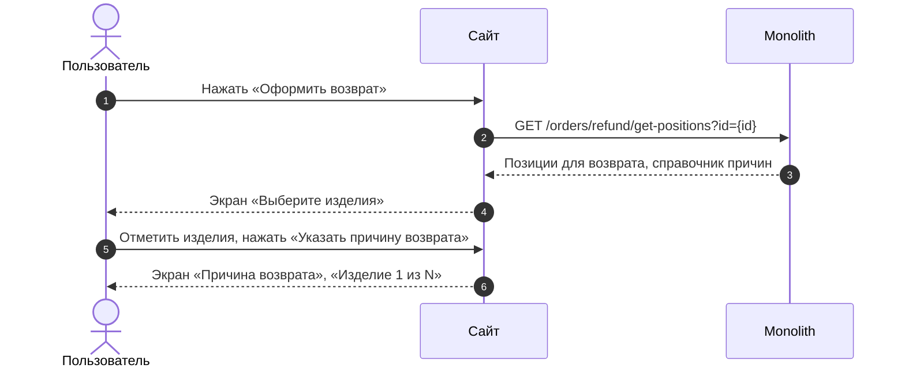
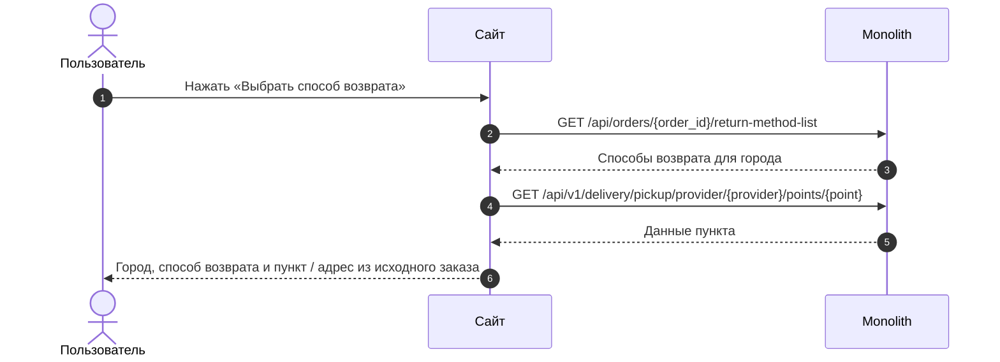
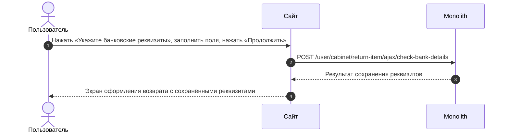

# SRS: Возвраты 2.0 — сайт

## Полезные материалы

| Название | Ссылка |
|---|---|
| BRD / ТЗ | [brd.md](../brd.md) |
| Epic | ECOMDEV-2246 [MVP] Возвраты, ECOMDEV-2256 [Post-MVP] Возвраты — [user-story.md](../user-story/user-story.md) |
| Макеты | [v2 Создание возврата](<../mockups/v2 Создание возврата/>) |
| Макеты | [v2.1 После создания возврата (просмотр и раздел возвратов)](<../mockups/v2.1 После создания возврата (просмотр и раздел возвратов)/>) |
| API-документация | [reference/api/web/](../reference/api/web/) |
| API-документация | [[B][Web] order-card-return_task-v2.md](<../backend/US-01/[B][Web] order-card-return_task-v2.md>), [[B][Web] refund-get-positions_task-v2.md](<../backend/US-01/[B][Web] refund-get-positions_task-v2.md>) |
| ADR / решения | [adr/](../adr/) |
| Другие материалы | [Use Case](../use-case/use-case.md), [Спецификация экранов](../screen-spec/screen-spec.md), [TO-BE шаги сайта](../to-be/web/) |
| Другие материалы | [SRS мобильного приложения](./srs-mobile.md) |

---

# User Story

## Оформление возврата

### US 1.1. Условия отображения кнопки возврата заказа

**Как** клиент, совершивший покупку, **я хочу** иметь возможность начать оформление возврата из карточки заказа, **чтобы** самостоятельно оформить возврат без обращения в поддержку.

### Дизайн

Макеты: [v2 Создание возврата](<../mockups/v2 Создание возврата/>)

### Сценарий

#### Основная последовательность «Условия отображения кнопки возврата заказа»

| Шаг | Исполнитель | Описание |
|---:|---|---|
| 1 | Пользователь | Открывает страницу заказа |
| 2 | Система | Получает данные страницы заказа (`GET /profile/view/{id}`) |
| 3 | Система | Определяет категорию клиента (`cms_users_user.is_vic`) |
| 4 | Система | Проверяет, что с даты получения заказа прошло <= 14 дней для обычного клиента (`cms_users_user.is_vic = 0`) или <= 30 дней для клиента F&F (`cms_users_user.is_vic = 1`) |
| 5 | Система | Проверяет заявки на возврат по позициям заказа |
| 6 | Система | Определяет, что хотя бы для одной позиции заказа нет активной заявки на возврат (!= "Отменен") |
| 7 | Система | Отображает кнопку «Оформить возврат» в активном состоянии |
| 8 | Система | Рассчитывает дату, до которой можно оформить заявку: «дата получения заказа + 14 дней» для обычного клиента, «дата получения заказа + 30 дней» для клиента F&F |
| 9 | Система | Отображает под кнопкой текст «Можно вернуть изделия до [Дата]» и кликабельную ссылку «Правила возврата» |

##### Опционально

1. Шаг 6. Если заявки на возврат для всех позиций заказа отсутствуют, то кнопка оформления возврата отображается и активна.
2. Шаг 6. Если в заказе есть позиция, на которую ещё не оформлен возврат, и хотя бы для одной позиции есть активная заявка (!= "Отменен"), то кнопка оформления возврата отображается и активна.
3. Шаг 6. Если для позиции есть заявка в статусе "Отменен" и для этой позиции отсутствуют другие активные заявки (!= "Отменен"), то кнопка оформления возврата отображается и активна.
4. Шаг 4. Если с даты получения заказа прошло > 14 дней для обычного клиента или > 30 дней для клиента F&F, то кнопка оформления возврата не отображается.
5. Шаг 6. Если для всех позиций заказа есть активные заявки на возврат (!= "Отменен"), то кнопка оформления возврата не отображается.

### Взаимодействие компонентов

### Задачи

| Название | Ссылка |
|---|---|

---

### US 1.2. Выбор изделий и причин возврата

**Как** клиент, оформляющий возврат, **я хочу** выбрать одно или несколько изделий из заказа и указать причину возврата для каждого выбранного изделия, **чтобы** сформировать возврат только для тех изделий, которые я хочу вернуть.

### Дизайн

Макеты: [v2 Создание возврата](<../mockups/v2 Создание возврата/>)

### Сценарий

#### Предусловия

1. Кнопка «Оформить возврат» отображается и активна.

#### Основная последовательность «Выбор изделий и причин возврата»

| Шаг | Исполнитель | Описание |
|---:|---|---|
| 1 | Пользователь | Нажимает кнопку «Оформить возврат» |
| 2 | Система | Получает позиции заказа, доступные для возврата, и справочник причин возврата (`GET /orders/refund/get-positions?id={id}`) |
| 3 | Система | Отображает экран «Выберите изделия»: только позиции без заявок на возврат или со статусом заявки = "Отменен" |
| 4 | Система | Отображает каждую единицу позиции заказа с количеством >= 2 как отдельное изделие |
| 5 | Система | Отображает кофр или подарок отдельной позицией заказа, не выбранной автоматически в состав заявки на возврат |
| 6 | Система | Отображает предупреждение о необходимости вернуть изделия в полной комплектации |
| 7 | Пользователь | Отмечает чекбоксом N изделий |
| 8 | Система | Меняет заголовок экрана на «Выберите изделия · N» и делает кнопку «Указать причину возврата» активной |
| 9 | Пользователь | Нажимает «Указать причину возврата» |
| 10 | Система | Открывает экран «Причина возврата» с подзаголовком «Изделие 1 из N» |
| 11 | Пользователь | Выбирает группу причин из выпадающего списка |
| 12 | Система | Отображает детализированный список причин (радио-баттоны) |
| 13 | Пользователь | Выбирает конкретную причину из списка |
| 14 | Система | Переходит к «Изделию 2 из N»; шаги 11–13 повторяются для каждого выбранного изделия |
| 15 | Система | Делает кнопку «Выбрать способ возврата» активной |

##### Опционально

1. Шаг 7. Если клиент не выбрал ни одного изделия, то кнопка «Указать причину возврата» находится в неактивном состоянии.
2. Шаг 15. Если причина возврата указана не для всех выбранных изделий, то кнопка «Выбрать способ возврата» неактивна.

### Взаимодействие компонентов

### Задачи

| Название | Ссылка |
|---|---|

---

### US 1.3. Выбор способа возврата

**Как** клиент, оформляющий возврат, **я хочу** выбрать способ возврата товаров, **чтобы** успешно завершить оформление заявки на возврат.

### Дизайн

Макеты: [v2 Создание возврата](<../mockups/v2 Создание возврата/>)

### Сценарий

#### Предусловия

1. Клиент указал причины возврата для выбранных позиций.
2. Клиент оформляет возврат в городе исходного заказа; способ и адрес доставки исходного заказа доступны для сценария возврата.

#### Основная последовательность «Выбор способа возврата»

| Шаг | Исполнитель | Описание |
|---:|---|---|
| 1 | Пользователь | Нажимает кнопку «Выбрать способ возврата» |
| 2 | Система | Определяет город возврата из данных заказа |
| 3 | Система | Получает данные города (TBD) |
| 4 | Система | Получает способы возврата для города (`GET /api/orders/{order_id}/return-method-list`) |
| 5 | Система | Отображает только способы возврата, применимые к этому городу |
| 6 | Система | Автоматически выбирает способ возврата, соответствующий исходному заказу |
| 7 | Система | Предзаполняет адрес возврата данными из исходного заказа; для СДЭК / 5Post — подставляет пункт выдачи из исходного заказа (`GET /api/v1/delivery/pickup/provider/{provider}/points/{point}`); для Магазина 12 STOREEZ — подставляет магазин из исходного заказа, если он есть в списке магазинов, принимающих возвраты (`GET /content/showrooms/showrooms-return` (новый метод)) |
| 8 | Система | Для способов СДЭК, 5Post, Магазин 12 STOREEZ, Почта России рассчитывает дату сдачи «дата оформления заявки + 10 календарных дней» и отображает текст «Вернуть до [рассчитанная дата]» |

##### Опционально

**Альтернативные сценарии**

1. Шаг 5. Если клиент открыл шторку выбора города и закрыл её, не выбрав город, то клиент остаётся на экране оформления возврата с ранее выбранным городом и способами возврата; экрана с призывом «Укажите город» нет (`FR-44`).
2. Шаг 2. Если клиент самостоятельно выбирает страну или город из списка в шторке, открытой нажатием на поле города (`GET /api/v1/delivery/geo/countries/{countryIso}/cities`), то шторка закрывается, система применяет выбранный город и продолжает с шага 4.
3. Шаг 5. Если клиент выбирает другой город при заполненном городе возврата, то система отображает модальное окно «Смена города» с предупреждением о сбросе способа возврата и кнопками «Продолжить» и «Отмена».
4. Альтернатива 3. Если клиент нажимает «Продолжить», то ранее выбранный способ возврата и все введённые для способов данные (адрес, дата и интервал, точка передачи) сбрасываются (`FR-43`), система применяет новый город, отображает доступные для него способы возврата и автоматически выбирает первый по приоритету способ возврата.
5. Альтернатива 3. Если клиент нажимает «Отмена», то модальное окно закрывается, и клиент возвращается на экран выбора способа возврата без изменения данных.
6. Шаг 6. Если способ доставки исходного заказа недоступен для возврата и для города доступен хотя бы один другой способ, то система автоматически выбирает первый доступный способ возврата по приоритету.
7. Шаг 6. Если клиент оформляет возврат в городе, отличном от города исходного заказа, и для города доступны способы возврата, то система автоматически выбирает первый доступный способ возврата по приоритету.
8. Шаг 7. Если способ доставки исходного заказа доступен для возврата, а конкретная точка или адрес из исходного заказа недоступны, то система выбирает способ, соответствующий исходному заказу, и оставляет поле адреса или точки возврата незаполненным.
9. Шаг 7. Если клиент снова выбирает город исходного заказа после смены города, то система не подставляет адрес и точку возврата из исходного заказа: данные были сброшены при смене города, клиент заполняет их заново (`FR-43`).
10. Шаг 7. Если клиент в городе исходного заказа вручную сменил способ возврата, а затем снова выбрал способ, соответствующий исходному заказу, то система предзаполняет адрес возврата данными из исходного заказа, если клиент не изменял его для этого способа.
11. Шаг 6. Если клиент выбирает способ «Курьер», то система отображает поля для ввода адреса (Улица, Дом, Квартира), выбора даты и временного интервала (интервалы — TBD); пока улица или дом не заполнены, вместо выбора даты и интервала отображается текст «Сначала укажите адрес»; после ввода улицы и дома система отображает доступные даты и интервалы (квартира не влияет, `FR-42`); после заполнения адреса и выбора даты и интервала данные курьерской доставки считаются корректно заполненными.
12. Альтернатива 11. Если клиент оформляет возврат в последний допустимый день срока (14-й день для всех клиентов), то календарь отображает даты приезда курьера на 3 дня вперёд за пределы основного срока возврата (технический буфер курьерского канала), и клиент может выбрать любую из них.
13. Шаг 7. Если для способа СДЭК / 5Post точка возврата не выбрана, то система отображает кнопку «Выберите пункт»; для Магазина 12 STOREEZ — «Выберите магазин».
14. Альтернатива 13. Если клиент нажимает «Выберите пункт» / «Выберите магазин», выбирает доступную точку на карте или из списка (СДЭК / 5Post — `GET /api/v1/delivery/pickup/provider/{provider}/points`; магазин — `GET /content/showrooms/showrooms-return` (новый метод)) и подтверждает выбор в детальной карточке точки (СДЭК / 5Post — `GET /api/v1/delivery/pickup/provider/{provider}/points/{point}`; магазин — `GET /content/showrooms/showroom-view?storeCode={store_code}`), то система возвращает клиента на экран оформления возврата и отображает адрес выбранной точки. Детальная карточка магазина содержит название, адрес, как добраться, время работы, телефон и парковку (поле без данных не выводится); срок доставки и срок возврата не показываются (`FR-46`).
15. Шаг 7. Если клиент нажимает «Изменить» в блоке точки возврата, выбирает новую точку и подтверждает выбор, то система обновляет адрес выбранной точки на экране оформления возврата.
16. Шаг 7. Если клиент выбрал точку или ввёл адрес, дату и интервал для способа, переключился на другой способ в том же городе и снова выбрал прежний способ, то система показывает ранее выбранную точку или введённые данные (`FR-43`).
17. Шаг 5. Если возврат оформляется для города «Калининград» или Калининградской области, то способ «Почта России» отображается в списке доступных способов; для других городов РФ — не отображается.
18. Шаг 6. Если клиент выбирает способ «Почта России», то система отображает инструкцию по возврату, адрес склада для отправки и ссылку «Пункты Почты России»; по нажатию на ссылку открывается карта отделений (Калининград и Калининградская область) на внешнем ресурсе Почты России в браузере или приложении.

**Ошибочные сценарии**

19. Шаг 5. Если для выбранного города отсутствуют доступные способы возврата, то система отображает сообщение об отсутствии доступных способов возврата и кнопку «Написать нам»; поле выбора города остаётся доступным для нажатия.
20. Альтернатива 11 (под вопросом). Если у курьерской службы отсутствуют свободные даты или интервалы, то система отображает сообщение «К сожалению, нет свободных дат для вызова курьера» и предлагает выбрать другой способ возврата.
21. Альтернатива 11. Если введённый адрес не позволяет автоматически определить почтовый индекс (`GET /api/v1/delivery/geo/countries/{countryIso}/addresses/{geo_id}/details`), то система отображает дополнительное поле «Индекс»; при нажатии «Подтвердить возврат» с незаполненным индексом система не отправляет заявку и подсвечивает поле «Индекс» красным контуром с текстом «Укажите индекс».

### Взаимодействие компонентов

### Задачи

| Название | Ссылка |
|---|---|

---

### US 1.4. Определение способа возврата денежных средств

**Как** клиент, оформляющий возврат, **я хочу** понимать, каким способом мне будут возвращены денежные средства, и при необходимости указать банковские реквизиты, **чтобы** получить денежные средства за возвращённые изделия.

### Дизайн

Макеты: [v2 Создание возврата](<../mockups/v2 Создание возврата/>)

### Сценарий

#### Предусловия

1. Исходный заказ оплачен онлайн (банковская карта, СБП, «Долями» / «Подели») и не оплачивался подарочным сертификатом.

#### Основная последовательность «Определение способа возврата денежных средств»

| Шаг | Исполнитель | Описание |
|---:|---|---|
| 1 | Пользователь | Открывает экран оформления возврата |
| 2 | Система | Определяет способ оплаты исходного заказа по данным формы возврата (`GET /orders/refund/get-positions?id={id}`) |
| 3 | Система | Отображает в блоке «Возврат средств» текст «На банковскую карту, с которой была произведена оплата» (`FR-45`) |
| 4 | Система | Скрывает блок «Банковские реквизиты» |
| 5 | Система | Отображает текст «Если вам необходимо получить возврат другим способом или на другие реквизиты, пожалуйста, обратитесь в Отдел дружбы с клиентами» со ссылкой «Отдел дружбы с клиентами» (`FR-47`) |
| 6 | Система | Отображает в блоке «Итого к возврату» рассчитанную для выбранных изделий денежную сумму |
| 7 | Пользователь | Продолжает оформление возврата без ввода дополнительных данных |

##### Опционально

1. Шаг 3. Если исходный заказ оплачен подарочным сертификатом полностью или частично, то текст о возврате на карту не отображается, а отображается блок «Банковские реквизиты» — как при оплате при получении (альтернатива 3); по реквизитам возвращается вся сумма, при частичной оплате — включая онлайн-часть. На сертификат деньги не возвращаются (`RULE-37`, `ADR-RET-046`); возврат на сертификат — Post-MVP (US 14).
2. Шаг 5. Если клиент нажимает на ссылку «Отдел дружбы с клиентами», то система открывает окно «Отдел дружбы с клиентами» с часами работы отдела и действиями «Позвонить» и «Написать».
3. Шаг 3. Если исходный заказ оплачен при получении или полностью или частично подарочным сертификатом (`return.is_bank_data_required = true`) и банковские реквизиты ещё не заполнены, то в блоке «Банковские реквизиты» система отображает кнопку «Укажите банковские реквизиты».
4. Альтернатива 3. Если клиент нажимает «Укажите банковские реквизиты», заполняет на экране «Банковские реквизиты» ФИО получателя, название банка, БИК банка и номер лицевого счёта и нажимает «Продолжить», то система сохраняет реквизиты (`POST /user/cabinet/return-item/ajax/check-bank-details`), возвращает клиента на экран оформления возврата и отображает сохранённые реквизиты (ФИО получателя, название банка и номер счёта).
5. Альтернатива 4. Если клиент ранее указывал банковские реквизиты в другой заявке на возврат, то при открытии экрана «Банковские реквизиты» поля не заполнены.
6. Альтернатива 4. Если клиент вводит номер кредитного счёта, начинающийся с «30232810», и поле «Номер банковской карты» пустое, то кнопка «Продолжить» неактивна; после заполнения поля «Номер банковской карты» кнопка становится активной.
7. Альтернатива 4. Если клиент нажимает на блок с заполненными реквизитами, то система открывает экран «Банковские реквизиты» с предзаполненными данными; после изменения и нажатия «Продолжить» система обновляет отображение реквизитов на экране оформления возврата.
8. Шаг 6. Если для оформляемого возврата предусмотрен возврат бонусов или баллов, то система отображает в блоке «Баллы к возврату» количество баллов к возврату.

### Взаимодействие компонентов

### Задачи

| Название | Ссылка |
|---|---|

---

### US 1.5. Подтверждение и создание заявки на возврат

**Как** клиент, **я хочу** отправить заполненную форму и увидеть экран подтверждения заявки, **чтобы** быть уверенным, что мой возврат принят в работу, и легко отслеживать его статус.

### Дизайн

Макеты: [v2 Создание возврата](<../mockups/v2 Создание возврата/>)

### Сценарий

#### Предусловия

1. Клиент заполнил все обязательные данные оформления возврата.

#### Основная последовательность «Подтверждение и создание заявки на возврат»

| Шаг | Исполнитель | Описание |
|---:|---|---|
| 1 | Пользователь | Подтверждает создание возврата |
| 2 | Система | Проверяет, что срок подачи заявки не истёк |
| 3 | Система | Проверяет, что выбранные изделия и способ возврата остаются доступными |
| 4 | Система | Создаёт заявку на возврат (TBD) |
| 5 | Система | Делает созданную заявку доступной клиенту для дальнейшего просмотра |

##### Опционально

1. Шаг 2. Если срок подачи заявки истёк, то заявка не создаётся, и система информирует клиента о недоступности оформления возврата.
2. Шаг 4. Если происходит ошибка создания заявки, то заявка не считается созданной, система информирует клиента, что заявку не удалось создать, ранее указанные данные остаются доступными без повторного ввода, и клиент может повторить попытку с шага 1.

### Задачи

| Название | Ссылка |
|---|---|

---

### US 1.6. Скачивание пустого бланка заявления без авторизации

**Как** неавторизованный покупатель, **я хочу** скачать пустой бланк заявления на возврат, **чтобы** распечатать и заполнить его вручную для возврата товара через розничный магазин без входа в личный кабинет.

### Сценарий

#### Предусловия

1. Клиент не авторизован в личном кабинете.
2. Клиент находится в блоке «Вернуть в розничный магазин 12 STOREEZ» на странице правил возврата.

#### Основная последовательность «Скачивание пустого бланка заявления без авторизации»

| Шаг | Исполнитель | Описание |
|---:|---|---|
| 1 | Пользователь | Нажимает на ссылку «скачайте его по этой ссылке» |
| 2 | Система | Скачивает бланк заявления на возврат в формате PDF на устройство клиента |

### Задачи

| Название | Ссылка |
|---|---|

---

## Просмотр возвратов

### US 2. Просмотр списка возвратов

**Как** авторизованный клиент, **я хочу** видеть список оформленных возвратов, **чтобы** находить нужную заявку на возврат, понимать текущее состояние и перейти к подробной информации.

### Дизайн

Макеты: [v2.1 После создания возврата (просмотр и раздел возвратов)](<../mockups/v2.1 После создания возврата (просмотр и раздел возвратов)/>)

### Сценарий

#### Предусловия

1. У клиента есть один или несколько оформленных возвратов в любом статусе.

#### Основная последовательность «Просмотр списка возвратов»

| Шаг | Исполнитель | Описание |
|---:|---|---|
| 1 | Пользователь | Открывает список возвратов |
| 2 | Система | Получает список возвратов клиента (TBD) |
| 3 | Система | Отображает для каждого возврата информацию, позволяющую идентифицировать возврат и понять его текущее состояние |
| 4 | Пользователь | Открывает выбранный возврат |
| 5 | Система | Открывает детальную информацию по заявке |

##### Опционально

1. Шаг 3. Если у клиента нет ни одного оформленного возврата, то система информирует клиента об отсутствии оформленных возвратов и предоставляет возможность перейти к покупкам в каталог.

### Задачи

| Название | Ссылка |
|---|---|

---

### US 3. Просмотр детальной информации по заявке на возврат

**Как** клиент, оформивший возврат, **я хочу** иметь полный доступ к информации и материалам по своей заявке, **чтобы** легко контролировать статус возврата на каждом этапе и оперативно получать нужные данные без обращения в поддержку.

### Дизайн

Макеты: [v2.1 После создания возврата (просмотр и раздел возвратов)](<../mockups/v2.1 После создания возврата (просмотр и раздел возвратов)/>)

### Сценарий

#### Предусловия

1. Заявка на возврат была ранее успешно создана.

#### Основная последовательность «Просмотр детальной информации по заявке на возврат»

| Шаг | Исполнитель | Описание |
|---:|---|---|
| 1 | Пользователь | Открывает страницу детальной информации по заявке |
| 2 | Система | Загружает информацию по заявке (TBD) |
| 3 | Система | Отображает статус, инструкцию, логистику, способ выплаты и состав изделий |

##### Опционально

1. Шаг 3. Плашка текущего статуса не раскрывается: история статусов — Post-MVP (US 15, `ADR-RET-048`). Если для способа возврата не задан текст инструкции «Что дальше», блок не отображается (`FR-48`).
2. Шаг 3. Если клиент нажимает на иконку скачивания документа, то система генерирует PDF-файл заявления на основе данных заявки (TBD), и файл скачивается на устройство клиента.
3. Шаг 3. Если заявка находится в статусе «Выполнен» и по заявке успешно сформирован кассовый чек возврата, то клиенту доступна кнопка «Скачать чек»; по нажатию файл кассового чека скачивается на устройство клиента (TBD).
4. Шаг 3. Если клиент нажимает на иконку «Копировать» рядом с номером возврата, то номер возврата сохраняется в буфер обмена устройства, и система отображает всплывающее уведомление «Номер возврата скопирован».
5. Шаг 3. Если клиент нажимает на карточку товара в блоке «Изделия к возврату», то система перенаправляет клиента на страницу соответствующего товара в каталоге.
6. Шаг 3. Если заявка создана со способом сдачи «Розничный магазин», то система генерирует и отображает персональный QR-код заявки; QR-код доступен для сканирования сотрудником магазина при приёме товара и может быть предъявлен с экрана устройства без печати и без подключения к интернету.
7. Шаг 3. Если заявка создана со способом возврата «СДЭК» или «5Post», то система отображает информацию, что код для сдачи (СДЭК — штрихкод и номер накладной; 5Post — QR-код и PIN) будет направлен транспортной компанией по SMS на номер телефона и на email, указанные в заказе.
8. Шаг 3. Если заявка находится в статусе «Отклонен» и по результатам проверки зафиксирована причина отказа, то система отображает статус «Отклонен» и блок с текстом причины отказа.

### Задачи

| Название | Ссылка |
|---|---|

---

### US 8. Просмотр идентификаторов для передачи изделий в ТК (QR / Штрихкоды)

**Как** клиент, оформляющий возврат через партнёрские службы доставки, **я хочу** получать логистические идентификаторы, сформированные партнёром, **чтобы** предъявить их в пункте приёма для быстрой идентификации и отправки товара.

### Дизайн

Макеты: [v2.1 После создания возврата (просмотр и раздел возвратов)](<../mockups/v2.1 После создания возврата (просмотр и раздел возвратов)/>)

### Сценарий

#### Предусловия

1. Клиент находится на странице детальной информации по заявке.
2. Для заявки сформированы партнёрские данные приёмки.

#### Основная последовательность «Просмотр идентификаторов для передачи изделий в ТК»

| Шаг | Исполнитель | Описание |
|---:|---|---|
| 1 | Система | Получает данные заявки (TBD) |
| 2 | Система | Отображает пункт «Показать код» |
| 3 | Пользователь | Нажимает на пункт «Показать код» |
| 4 | Система | Открывает модальное окно с графическим кодом (QR или штрихкод) и его числовым дубликатом (номер накладной / PIN) |
| 5 | Пользователь | Нажимает кнопку «Закрыть» или иконку крестика в углу окна |
| 6 | Система | Закрывает модальное окно и возвращает клиента на страницу деталей возврата |

##### Опционально

1. Шаг 2. Если партнёрская служба ещё не сформировала данные приёмки, то пункт «Показать код» не отображается до момента успешного получения данных от партнёра.
2. Шаг 2. Если клиент фактически передал товар в пункт приёма и система зафиксировала этот факт (статус передачи товара — TBD), то пункт «Показать код» не отображается.

### Задачи

| Название | Ссылка |
|---|---|

---

## Жизненный цикл заявки

### US 4. Отмена заявки на возврат

**Как** клиент, оформивший заявку на возврат, **я хочу** иметь возможность самостоятельно отменить созданную заявку, **чтобы** не возвращать товар, если я передумал, или оформить новую заявку, если допустил ошибку (выбрал не тот товар или способ сдачи).

### Сценарий

#### Предусловия

1. Клиент находится на странице деталей возврата.
2. Заявка находится в статусе, допускающем отмену (статусы — TBD).

#### Основная последовательность «Отмена заявки на возврат»

| Шаг | Исполнитель | Описание |
|---:|---|---|
| 1 | Система | Предоставляет клиенту возможность инициировать отмену возврата |
| 2 | Пользователь | Инициирует отмену возврата |
| 3 | Система | Запрашивает у клиента подтверждение действия (формат диалога — TBD) |
| 4 | Пользователь | Подтверждает отмену заявки |
| 5 | Система | Отменяет заявку (TBD) |
| 6 | Система | Изменяет статус заявки на «Отменен» |
| 7 | Система | Информирует клиента об успешной отмене (финальный экран после отмены — TBD) |
| 8 | Система | Делает товары из отменённой заявки снова доступными для оформления нового возврата, если не истёк срок возврата |

##### Опционально

1. Шаг 1. Если заявка находится в статусе, не допускающем отмену (статусы — TBD), то система скрывает возможность отмены возврата.
2. Шаг 4. Если клиент отказывается от действия (закрывает окно или нажимает «Отмена»), то система возвращает клиента на страницу деталей заявки без изменения её статуса.

### Задачи

| Название | Ссылка |
|---|---|

---

### US 5. Автоотмена заявки на возврат по истечении срока передачи

**Как** менеджер по возвратам, **я хочу**, чтобы заявка автоматически отменялась, если клиент не передал товар в срок, **чтобы** не держать в обработке неактуальные возвраты и не резервировать под них ресурсы.

### Сценарий

#### Предусловия

1. Заявка на возврат создана.

#### Основная последовательность «Автоотмена заявки на возврат по истечении срока передачи»

| Шаг | Исполнитель | Описание |
|---:|---|---|
| 1 | Система | Определяет наступление следующего календарного дня после окончания установленного срока передачи изделий |
| 2 | Система | Проверяет, что изделия по возврату не были переданы в логистику / магазин |
| 3 | Система | Автоматически отменяет заявку (TBD) |

##### Опционально

1. Шаг 2. Если изделия были переданы в пределах установленного срока и факт передачи зафиксирован системой, то заявка не отменяется автоматически.
2. Шаг 1. Если для возврата выбран способ «Курьер» и дата и временной интервал приезда курьера выходят за рамки стандартного 14-дневного срока подачи заявки, то по истечении этого срока заявка остаётся активной до наступления согласованной даты приезда курьера.
3. Шаг 1. Если для возврата выбран способ «Курьер», изделия не были переданы курьеру и дата приезда курьера не была перенесена клиентом или поддержкой, то заявка автоматически отменяется на следующий день после согласованной даты приезда курьера.

### Задачи

| Название | Ссылка |
|---|---|

---

### US 6. Исполнение возврата денежных средств и восстановление бонусов

**Как** клиент, **я хочу** получить деньги и потраченные бонусы за возвращённый товар, **чтобы** завершить процесс возврата и вернуть свои средства.

### Сценарий

#### Предусловия

1. Соответствие возвращаемых изделий условиям возврата подтверждено складом.
2. При оплате заказа клиент использовал бонусные баллы.

#### Основная последовательность «Исполнение возврата денежных средств и восстановление бонусов»

| Шаг | Исполнитель | Описание |
|---:|---|---|
| 1 | Система | Фиксирует успешную приёмку товара |
| 2 | Система | Автоматически восстанавливает на бонусный счёт клиента бонусные баллы, применённые к подтверждённым единицам, в течение 1–3 дней независимо от момента выплаты денежных средств (TBD) |
| 3 | Уполномоченный сотрудник | Выполняет возврат средств через платёжного провайдера |
| 4 | Система | Получает подтверждение успешного перевода от провайдера (TBD) |
| 5 | Система | Обновляет статус выплаты |

##### Опционально

1. Шаг 2. Если условиям возврата соответствует только часть изделий (остальные отклонены), то бонусные баллы восстанавливаются только за подтверждённые изделия в размере, применённом к каждой единице изделия при покупке.
2. Шаг 3. Если исходный заказ оплачен подарочным сертификатом полностью или частично, то вся сумма за подтверждённые изделия, включая онлайн-часть при частичной оплате, перечисляется на банковские реквизиты из заявки; на сертификат деньги не возвращаются (`RULE-37`, `ADR-RET-046`; возврат на сертификат — Post-MVP, US 14).

### Задачи

| Название | Ссылка |
|---|---|

---

### US 7. Уведомление об истекающем сроке передачи возврата

**Как** клиент, **я хочу** получать напоминание, если срок передачи моего возврата подходит к концу, **чтобы** не пропустить дедлайн и вовремя передать товар в доставку.

### Сценарий

#### Предусловия

1. У клиента есть активная заявка на возврат (статус «Создан»).

#### Основная последовательность «Уведомление об истекающем сроке передачи возврата»

| Шаг | Исполнитель | Описание |
|---:|---|---|
| 1 | Система | Определяет, что до окончания установленного срока передачи остаётся ровно 1 день (24 часа) |
| 2 | Система | Проверяет, что изделия по возврату ещё не переданы логистическому партнёру или в магазин |
| 3 | Система | Автоматически отправляет клиенту уведомление (Push / Email) с напоминанием об истекающем сроке передачи возврата (TBD) |

### Задачи

| Название | Ссылка |
|---|---|

---

### US 10. CSI-опрос после возврата

**Как** клиент, получивший возврат денежных средств, **я хочу** оценить скорость и удобство процесса возврата и оставить обратную связь, **чтобы** компания учитывала мой опыт и улучшала процесс возврата.

### Сценарий

#### Предусловия

1. По заявке выполнен возврат денежных средств.

#### Основная последовательность «CSI-опрос после возврата»

| Шаг | Исполнитель | Описание |
|---:|---|---|
| 1 | Система | Фиксирует выполнение возврата денежных средств |
| 2 | Система | В тот же день направляет клиенту короткий CSI-опрос об оценке скорости и удобства процесса возврата (TBD) |
| 3 | Пользователь | Отвечает на CSI-опрос |
| 4 | Система | Сохраняет ответ |
| 5 | Система | Передаёт результаты опроса на платформу Отзывов (TBD) |

### Задачи

| Название | Ссылка |
|---|---|

---

## Администрирование возвратов

### US 11. Админка: настройка срока автоотмены по способу возврата

**Как** ответственный за процесс возврата, **я хочу** задавать в админке количество дней до автоотмены заявки отдельно для каждого способа возврата, **чтобы** менять срок без доработки системы.

### Сценарий

#### Основная последовательность «Настройка срока автоотмены по способу возврата»

| Шаг | Исполнитель | Описание |
|---:|---|---|
| 1 | Администратор | Открывает настройки способа возврата |
| 2 | Администратор | Указывает количество календарных дней |
| 3 | Администратор | Сохраняет настройку |
| 4 | Система | Сохраняет настройку (TBD) |
| 5 | Система | Для заявок этим способом рассчитывает срок как «дата создания заявки + указанное количество дней» |
| 6 | Система | Автоматически отменяет заявку на следующий день после истечения срока, если передача изделия не зафиксирована |

### Задачи

| Название | Ссылка |
|---|---|

---

### US 12. Админка: включение и отключение способов возврата по городу

**Как** ответственный за процесс возврата, **я хочу** включать и отключать способы возврата для каждого города, **чтобы** клиенту показывались только способы, реально доступные в его городе.

### Сценарий

#### Предусловия

1. Способ возврата включён для города.

#### Основная последовательность «Отключение способа возврата в городе»

| Шаг | Исполнитель | Описание |
|---:|---|---|
| 1 | Администратор | Отключает способ возврата для города |
| 2 | Администратор | Сохраняет настройку |
| 3 | Система | Сохраняет настройку (TBD) |
| 4 | Система | При оформлении возврата в этом городе не отображает клиенту этот способ |

##### Опционально

1. Предусловие 1. Если способ возврата отключён для города и администратор включает его и сохраняет настройку, то способ становится доступен клиенту при оформлении возврата в этом городе.

### Задачи

| Название | Ссылка |
|---|---|
