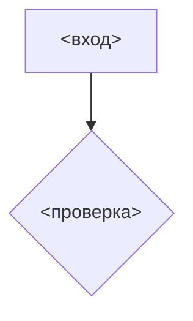

# <теги> <Раздел/экран>. <Что сделать>

<!--
Шаблон задачи на бэк. Правила заполнения — SKILL.md, раздел 3 (по названию блока).
Эталон: examples/ECOMDEV-2343.md (доработка существующего метода Mobile API с новой логикой).
Блок с пометкой «если» удаляется целиком, когда условие не выполнено.
Порядок блоков — порядок работы разработчика: новые данные БД → контракт → логика → маппинг.
Доработка существующего метода: описываются только изменения; существующая логика помечается AS-IS и не пересказывается.
В Трекере крупные таблицы, примеры и схемы сворачиваются в ; неподтверждённое помечается {red}(...) на месте.
Задача на Gate по этому шаблону не пишется — образец examples/ECOMDEV-1241.md.
-->

## Цель

<Одно-два предложения: что добавить / изменить и зачем.>

**Web**
- `<МЕТОД> /api/...`

**Mobile API**
- Site: `<МЕТОД> /mobile/...` — метод монолита, <дорабатывается / создаётся> в этой задаче
- Gate: `<МЕТОД> <путь на гейте>` — <гейт: `core.12stz.*` / `mobile.12stz.*`>, <передаёт запрос в Site / задача на гейт — в «Связях»>

## Описание реализации

Что требуется изменить:

1. <Доработать / создать> `<МЕТОД> <путь>`.
2. <Создать параметр / поле / таблицу `<имя>`> — раздел 1.
3. <Добавить / изменить поля запроса или ответа: `<поле>`, `<поле>`> — раздел 2.
4. <Изменить логику / расчёт `<поле>`> — раздел 3.

<Вне этой задачи: работы на других уровнях цепочки (гейт, downstream, внешние системы) — со ссылкой на задачу в «Связях». Если таких нет — строку удалить.>

---

#### 1. Создать новые данные БД
<!-- если нужен новый параметр админки, поле или таблица -->

<Создать <параметр в `cms_parameters` / поле `<таблица>.<поле>`> по аналогии с существующим `<...>`.>

| Атрибут | Значение |
|---|---|
| | |

#### 2. Входные и выходные параметры

<!-- Входные: если меняются; иначе одна строка «Входные параметры не меняются». -->

**Входные параметры**

| Параметр | Место | Тип данных | Обязательность | Описание |
|---|---|---|---|---|
| | `query` / `path` / `body` | | Да / Нет | |


<!-- если доработка меняет смысл или правило расчёта существующих полей -->

| Параметр | Было | Стало |
|---|---|---|
| | | |





| Поле | Тип данных | Описание |
|---|---|---|
| | `string \| null` | |

<Объект `<имя>` — отдельной таблицей с полными путями (`<объект>.<поле>`).>



```json
{
}
```

<Если ответ различается по веткам (тип доставки, статус) — пример на каждую ветку.>





<!-- если в ответе есть взаимоисключающие объекты -->
<`<объект>` формируется <всегда / при условии>. Из объектов `<a>`, `<b>`, `<c>` заполняется один, остальные равны `null`. Признак — `<таблица>.<поле>`. Проверки выполняются по порядку:>
1. <условие> → заполняется `<a>`;
2. <условие> → заполняется `<b>`;
3. иначе → заполняется `<c>`; <когда `<c>` = `null`>.

#### 3. Изменить логику <чего>
<!-- если меняется логика или появляются вычисляемые поля -->

**Эндпоинт:** `<МЕТОД> <путь Site>`


<!-- необязательно; при расхождении со шагами верен текст -->







**Проверки выполняются последовательно — от первого пункта к последнему.**

1. **<Шаг: проверка / получение данных / расчёт>**

   1. <условие> → <действие>; источник `<таблица>.<поле>`; результат — во внутреннюю переменную `<name>` / в поле `<поле ответа>`.
   2. <ветка «иначе»: что не выполняется дальше и какие значения получают поля ответа>.

2. **<Существующая проверка>**

   > **AS-IS:** далее применяется существующая логика <чего>. Она не изменяется в рамках данной задачи и должна соответствовать текущей реализации. Приведённые в задаче условия могут быть описаны укрупнённо; если фактическая AS-IS-логика отличается, необходимо сохранить текущую реализацию при условии, что она не противоречит новой логике.

   1. Существующие **AS-IS-проверки**: <условие>; <условие>.
   2. <Что из AS-IS-проверки исключено и чем заменено — если новая логика заменяет её часть.>

   > **Ограничение:** <известное влияние AS-IS-логики на новый расчёт, которое в задаче не прорабатывается>.

3. **Формирование `<поле>`**

   1. `<поле> = <значение>`, если одновременно выполняются условия: <...>.
   2. Если хотя бы одно условие не выполнено: `<поле> = <значение>`, `<поле> = <значение>`.

4. **<Существующий расчёт> — логика не меняется**
   <!-- если без него непонятно, что поле остаётся в ответе -->





| API | Тип данных | БД | Тип данных |
|---|---|---|---|
| `<поле>` | | `<таблица>.<поле>` | |
| `<вычисляемое поле>` | | Динамический расчёт: <формула через поля-источники> | — |

<Запрос → БД — отдельной таблицей, если появились новые входные параметры.>



### Ошибки
<!-- если меняется состав ошибок или метод новый; иначе одна строка «Состав ошибок не меняется» -->

| HTTP | Код (Web / Mobile) | `target` | Сообщение | Когда |
|---|---|---|---|---|
| | | | | |

### Совместимость с МП
<!-- если дорабатывается существующий метод Mobile API -->

| Изменение | Тип | Что увидит старая версия | Решение |
|---|---|---|---|
| | безопасное / опасное | | |

- Порядок выкатки: бэк раньше приложения, работает с обеими версиями.

## Тестирование
<!-- если QA не ведёт отдельную задачу -->

**Предусловия**
- <статус заказа, сроки, настройки админки, стенд>

**Критерии приёмки**
- <вход / данные → ожидаемый ответ>
- Внесены изменения в swagger.

## Открытые вопросы
<!-- если есть; сводка пометок {red}(...) из текста -->

| Вопрос | Кому |
|---|---|
| | |
