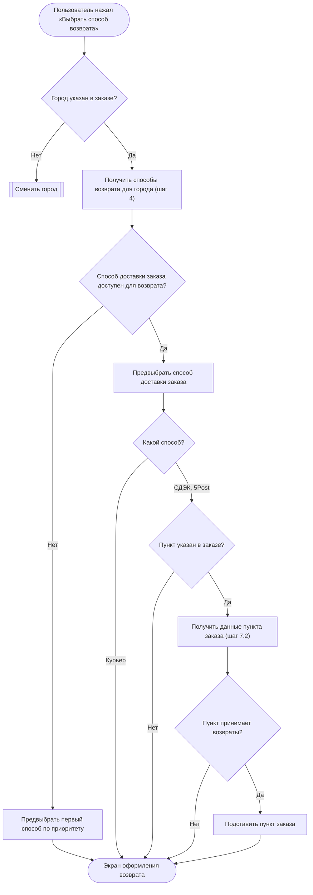

# Диаграмма логики сценария (flowchart)

Flowchart показывает, **какое условие ведёт по какой ветке** и что в каждой ветке делает пользователь или система. Скилл описывает только диаграмму. Где она стоит в документе и когда её добавлять, определяет скилл документа (например, `srs`).

## 1. Граница с sequence-диаграммой

| | Sequence (`sequence-diagram`) | Flowchart (этот скилл) |
|---|---|---|
| Вопрос | Кто кого вызывает и в каком порядке | Какое условие ведёт по какой ветке |
| Узлы | Участники: пользователь, приложение, шлюз, монолит, внешние системы | Действия и условия |
| Запросы | Фактический метод на стрелке | Нет. Только смысл действия, если от результата зависит развилка |
| Откуда данные, поля API | На стрелках и в таблице шагов | Нет. Условие формулируется по смыслу |

Одна и та же логика не рисуется дважды: цепочки вызовов — в sequence, правила ветвления — во flowchart, параметры запросов — в таблице шагов.

## 2. Узлы

| Узел | Синтаксис | Что пишется |
|---|---|---|
| Начало | `S([...])` | Событие, с которого начинается логика: «Пользователь нажал «Выбрать способ возврата»» |
| Конец | `Z([...])` | Итоговое состояние: «Экран оформления возврата», «Окно «Отдел дружбы с клиентами»» |
| Действие | `A["..."]` | Одно действие глаголом: «Подставить адрес из заказа», «Показать поле «Индекс»» |
| Условие | `B{"...?"}` | Вопрос: «Пункт принимает возвраты?», «Какой способ?», «Действие пользователя» |
| Переход | `CH[["..."]]` | Переход в другую диаграмму или последовательность: «Сменить город» |
| Цикл | `P[/"..."/]` | Перебор элементов: «Для каждой позиции заказа». Дальше — ромбы и действия для одного элемента |

## 3. Текст узлов

- **По смыслу, а не по полям.** «Город указан в заказе?», а не «`order_delivery.city_fias` заполнен?». «Способ доставки заказа доступен для возврата?», а не «`is_order_method = true`?». Поле, по которому проверяется условие, указано в таблице шагов.
- **Без технического синтаксиса.** В узлах нет HTTP-методов и адресов (`GET /…`), полей API, таблиц и колонок БД, кода и операторов (`==`, `&&`, `!=`).
- **Одно действие — один узел.** Узел не перечисляет параметры и не содержит условий. «Показать позиции с признаком возврата, кофр отдельно» — плохо: условие «с признаком» и «кофр отдельно» выносятся ромбами.
- **Каждое «если / только / кроме / с признаком» — ромб** с ветками, а не текст внутри действия.
- **Получение данных** рисуется узлом-действием, только если от результата зависит следующая развилка. Пишется смысл и ссылка на шаг: «Получить данные пункта заказа (шаг 7.2)» → «Пункт принимает возвраты?». Запрос, результат которого просто отображается, во flowchart не нужен.
- **Перед получением данных по ранее полученным данным** — ромб на их наличие: «Пункт указан в заказе?» → «Да» → «Получить данные пункта заказа». Без этого ромба непонятно, откуда берутся данные для запроса и что происходит, если их нет.
- **Тексты интерфейса** — в «ёлочках», как в макете или user story.

## 4. Ветки

- Каждая стрелка из ромба подписана: `|Да|`, `|Нет|` или вариант: `|Курьер|`, `|СДЭК, 5Post|`.
- У ромба «Действие пользователя» стрелки подписываются действиями: `|Нажал «Написать нам»|`.
- Каждая ветка доходит до конца, перехода или точки слияния. Висящих узлов нет.
- Ветка «ничего не делать» — стрелка сразу в точку слияния, без узлов-пустышек вроде «Поле оставить пустым» и «Точку не подставлять».
- Слияние веток — в следующий общий узел (действие или ромб).
- Повтор (пользователь исправил данные и нажал снова) — стрелка назад к узлу, с которого повторяется логика.
- Ветки, которые проверяет сервер и от которых зависит экран, тоже рисуются ромбами. Их можно сгруппировать в `subgraph Сервер`.

## 5. Согласованность с документом

- Каждый ромб соответствует ветке «Опционально» или альтернативной последовательности в таблице шагов. Логики, которой нет в шагах, на диаграмме нет, и наоборот.
- Каждое действие с получением данных соответствует шагу таблицы и стрелке в sequence. Ссылка «(шаг N)» указывает на этот шаг.
- Одна диаграмма — на одну последовательность (основную или альтернативную). Подпись над диаграммой — название последовательности.

## 6. Синтаксис Mermaid

- Блок ` ```mermaid ` и первая строка `flowchart TD`. Блок одинаково открывается в Markdown и Яндекс Вики.
- ID узлов — короткие латинские: `A`, `B1`, `K2`, `P3`. Группы веток — по букве: `K` — курьер, `P` — пункт, `M` — магазин.
- Текст узла в кавычках, если в нём есть скобки, кавычки или знаки: `A["Получить данные пункта заказа (шаг 7.2)"]`.
- В тексте узлов и подписях стрелок не использовать `;`, `#` и угловые скобки — Mermaid на них ломается.
- Больше ~40 узлов — разбить диаграмму: вынести часть в отдельную последовательность и сослаться узлом-переходом `[[...]]`.

## 7. Пример

Плохо — технические поля, запрос без источника данных, узлы-пустышки:

```
A{"order_delivery.city_fias заполнен?"}
F -->|СДЭК, 5Post| P1["GET /получить данные пункта выдачи"]
P2 -->|Нет| P4["Точку не подставлять"]
```

Хорошо:



## 8. Чек-лист

- [ ] Есть начало и хотя бы один конец или переход; все ветки доведены до них.
- [ ] Каждое условие — ромб; у каждой стрелки из ромба есть подпись.
- [ ] В узлах нет HTTP-методов, адресов, полей API, таблиц БД и кода.
- [ ] Получение данных показано только там, где от результата зависит развилка; перед ним — ромб на наличие исходных данных.
- [ ] Нет узлов-пустышек: ветка «ничего не делать» идёт сразу в слияние.
- [ ] Каждый ромб есть в таблице шагов как ветка «Опционально» или альтернативная последовательность, и наоборот.
- [ ] Синтаксис Mermaid без `;`, `#` и угловых скобок в подписях.
