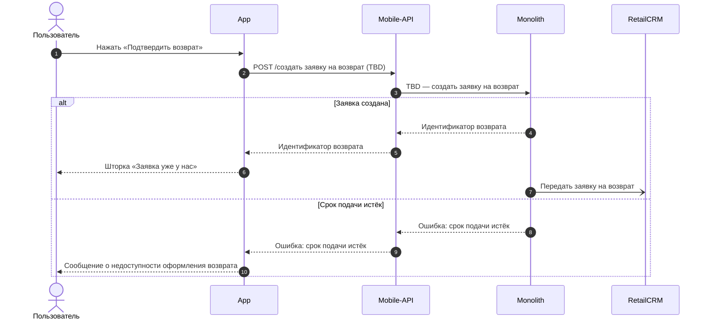

# Sequence-диаграмма (Mermaid)

Sequence показывает, **кто кого вызывает и в каком порядке**: какие запросы уходят от клиента, через какие системы проходят и что возвращается. Скилл описывает только диаграмму. Где она стоит в документе и когда её добавлять, определяет скилл документа (например, `srs`).

## 1. Граница с диаграммой логики

| | Sequence (этот скилл) | Flowchart (`flowchart-diagram`) |
|---|---|---|
| Вопрос | Кто кого вызывает и в каком порядке | Какое условие ведёт по какой ветке |
| Узлы | Участники: пользователь, приложение, шлюз, монолит, внешние системы | Действия и условия |
| Запросы | Фактический метод на стрелке | Нет |
| Ветки | Только те, от которых зависит набор вызовов или обработка ответа | Значимые условия и развилки |

Подробные правила ветвления (признаки, проверки, что показать на экране) рисуются на диаграмме логики, а не через `alt` на sequence.

## 2. Входные данные

- User Story и критерии приёмки — что делает пользователь и какой результат получает.
- Таблица шагов SRS или Use Case — порядок действий и запросов.
- Карта цепочек вызовов в `knowledge/` (`knowledge/architecture/`, `repo-map.md` репозиториев) — через какие системы фактически идёт запрос. Цепочку не придумывать: если она неизвестна, сообщить аналитику.

## 3. Участники

- Только фактически задействованные, в порядке слева направо по цепочке вызовов.
- Названия — как в подтверждённой архитектуре конкретного проекта (`knowledge/`). Таблица — пример объявлений, а не обязательные названия:

  | Участник | Объявление |
  |---|---|
  | Пользователь | `actor U as Пользователь` |
  | Мобильное приложение | `participant APP as App` |
  | Шлюз МП | `participant API as Mobile-API` |
  | Сайт | `participant WEB as Сайт` |
  | Монолит | `participant MON as Monolith` |
  | Внутренние сервисы | `participant BFB as monolith_bfb_ms`, `MSG as mindbox-srv-go` |
  | Внешние системы | `participant LOG as Logistics`, `GEO as Geo`, `MB as Mindbox`, `RCRM as RetailCRM`, `ONEC as 1C` |
  | Приложение на устройстве | `participant MAP as Приложение карт` |

- **Цепочка вызовов** строится по фактической подтверждённой архитектуре канала (источники — п. 2). Типовые маршруты — примеры, а не обязательная архитектура каждого запроса:
  - мобильное приложение: `App` → `Mobile-API` → `Monolith`; если Mobile-API обращается к системе напрямую (например, к `Geo`), стрелка идёт от `Mobile-API`;
  - сайт: `Сайт` → `Monolith`; если монолит обращается к системе через сервис-прослойку, прослойка — отдельный участник.
- **Все подтверждённые обращения к внутренним сервисам и внешним системам показываются обязательно**, даже если в таблице шагов их нет. Если запрос заканчивается в первом компоненте бэкенда, других участников нет.

## 4. Стрелки и подписи

| Что | Синтаксис |
|---|---|
| Запрос | `APP->>API: GET /api/orders/{id}` |
| Ответ | `API-->>APP: Карточка заказа` |
| Асинхронная передача (очередь, событие) | `MON-)RCRM: Передать заявку на возврат` |
| Действие внутри участника | `APP->>APP: Подставить адрес из заказа` |
| Показ пользователю | `APP-->>U: Экран оформления возврата` |

- Первая строка — `sequenceDiagram`, вторая — `autonumber`.
- На стрелке запроса — фактический метод и адрес, если они известны. Существующий метод, в том числе дорабатываемый, — без TBD.
- Новый метод помечается TBD, в том числе если путь предполагаемый: `GET /api/v1/stores/returns (TBD)`; если пути нет — `МЕТОД /действие по-русски (TBD)`: `POST /создать заявку на возврат (TBD)`. Неизвестный внутренний вызов — `TBD — <смысл запроса>`.
- Новый внешний метод не делает неизвестными все внутренние вызовы: подтверждённые внутренние пути и методы указываются как есть, TBD — только у действительно новых или неопределённых вызовов.
- На стрелке ответа — смысл ответа: «Способы возврата для города», «Ошибка: срок подачи истёк». Не JSON и не перечень полей.
- Подписи короткие, до ~60 символов. Не использовать `;`, `#` и угловые скобки — Mermaid на них ломается.
- Протокол указывается, если он не HTTP: `gRPC Geo.CityDetailsByGeoID`.
- Таблицы и SQL-запросы к БД не показываются; если обращение к БД важно для понимания, участник `DB as БД` и подпись по смыслу: «Сохранить заявку».

## 5. Блоки

| Блок | Когда | Синтаксис |
|---|---|---|
| `alt` / `else` | Подтверждённая ветка меняет последовательность вызовов, возвращаемые ответы или взаимодействие участников при обработке результата: успех и ошибка ответа, «пункт указан в заказе» → запрос / «не указан» → без запроса | `alt <условие>` … `else <условие>` … `end` |
| `opt` | Необязательная часть: действие пользователя, которое может не произойти, альтернативная последовательность | `opt <название>` … `end` |
| `loop` | Повторяющиеся вызовы | `loop <что повторяется>` … `end` |
| `rect` / `Note` | Не используются: группировка — через `opt` или отдельную диаграмму | — |

- Если различается только локальное отображение на клиенте, а взаимодействие компонентов не меняется (например, «пункт принимает возвраты» — подставить или не подставлять), отдельный `alt` не нужен: действие пишется одной стрелкой «Подставить пункт, если он принимает возвраты», а развилка — на диаграмме логики.
- Технические ошибки и варианты поведения, которых нет в подтверждённых требованиях, в ветки `alt` не добавляются.
- Короткая альтернативная последовательность — блок `opt <название>`. Длинная, со своими вызовами и действиями (сменить город, выбрать курьера), — отдельная диаграмма того же канала с подписью-названием последовательности.

## 6. Ошибки

- Показываются ответы с ошибкой, которые клиент обрабатывает по-разному: `alt Заявка создана` … `else Срок подачи истёк` … `else Ошибка проверки данных` … `end`.
- Каждая ветка ошибки доходит до того, что видит пользователь: `APP-->>U: Сообщение о недоступности оформления возврата`.
- Технические сбои (таймаут, недоступность сервиса) показываются, только если для них описано отдельное поведение.

## 7. Согласованность с документом

- Каждый вызов API из сценария документа есть на диаграмме, с тем же методом. Подтверждённые внутренние вызовы показываются на диаграмме и отдельных шагов в сценарии не требуют.
- Ветки `alt` показывают подтверждённые ветвления, которые влияют на набор вызовов и обработку ответов (п. 5). Соответствие каждой ветки `alt` отдельной ветке «Опционально» не требуется.
- Подписи вызовов, ответов и условий не ссылаются на номера шагов документа. `autonumber` — внутренняя нумерация сообщений Mermaid, а не нумерация шагов.
- Одна диаграмма — на одну последовательность или на историю, если последовательность одна. Подпись над диаграммой — название последовательности.
- История работает и на сайте, и в МП — по диаграмме на каждый канал (цепочки разные).

## 8. Пример



## 9. Файлы

- В SRS диаграмма — блок ` ```mermaid ` внутри документа: он одинаково открывается в Markdown и Яндекс Вики.
- Отдельная диаграмма AS-IS / TO-BE — файл `<объект>_sequence.md` в `as-is/diagrams/sequence/` или `requirements/diagrams/sequence/`: заголовок, блок ` ```mermaid ` и, если нужно, легенда участников. ID — `SEQ-<ТЕМА>-<...>` (`AGENTS.md` → «Легенда ID-префиксов»).

## 10. Чек-лист

- [ ] `sequenceDiagram` и `autonumber`.
- [ ] Участники — только задействованные, названия как в проекте, порядок по цепочке вызовов.
- [ ] Цепочка вызовов соответствует фактической подтверждённой цепочке канала; подтверждённые обращения к внутренним сервисам и внешним системам показаны все; лишних участников нет.
- [ ] Запрос — `->>`, ответ — `-->>`, асинхронная передача — `-)`.
- [ ] На запросах — фактический метод или `МЕТОД /действие по-русски`; на ответах — смысл, без JSON.
- [ ] `alt` только там, где ветка меняет набор вызовов; правила ветвления — на диаграмме логики.
- [ ] Ветки ошибок доходят до того, что видит пользователь.
- [ ] Каждый вызов API из сценария есть на диаграмме; подтверждённые внутренние вызовы не требуют отдельных шагов; ссылок на номера шагов нет.
- [ ] Новые методы — с TBD, существующие и дорабатываемые — без TBD.
- [ ] В подписях нет `;`, `#` и угловых скобок.
