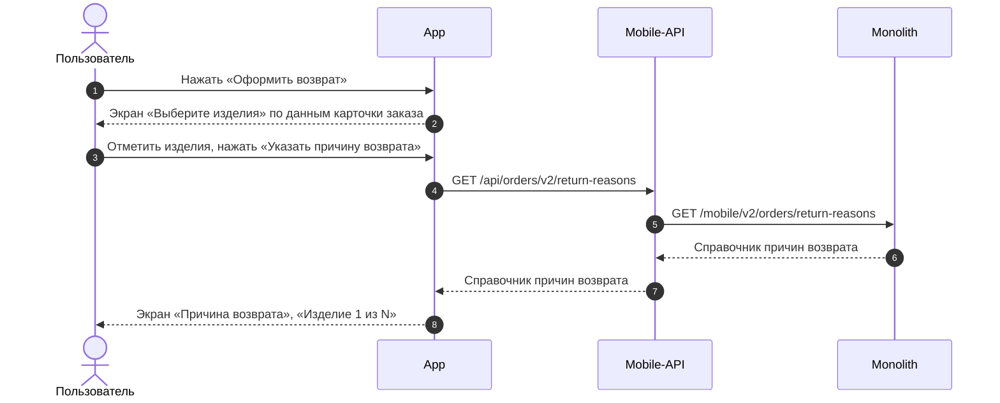

# SRS по шаблону

SRS описывает, что делает пользователь, что делает система и какие запросы при этом вызываются. Структура документа — [template.md](./template.md) (Markdown, по умолчанию) или [template-wiki.md](./template-wiki.md) (та же структура в разметке Яндекс Вики, п. 11). Готовый SRS — чистый документ для разработчиков: в нём нет рабочих пометок, рассуждений и инструкций.

## 1. Источники и их приоритет

1. **User story с критериями приёмки** — главный источник. Критерии приёмки не меняются и не пересказываются в формате Gherkin: каждый сценарий из них должен быть отражён шагом основной или альтернативной последовательности, веткой «Опционально» или блоком «Ограничение».
2. **BRD, ADR** — для контекста. Если они расходятся с user story, верна user story; расхождение сообщить аналитику (п. 9), в документ не писать.
3. **Ответы аналитика в переписке** — это решения. Они вносятся в документ как поведение системы: в шаг, ветку «Опционально», «Ограничение» или «Примечание». Сам разговор, дата ответа, кто ответил и что было до правки в документ не попадают.
4. Ничего не придумывать: поведение, тексты, поля, задачи, ссылки — только из источников.

## 2. Чья сторона описывается

- Сценарий пишется со стороны сайта / мобильного приложения и монолита.
- В **шагах сценария** показываются действия пользователя, действия приложения или сайта (отображение, проверки на экране, запросы к бэкенду) и действия бэкенда, от которых зависит экран: что он рассчитывает, проверяет, сохраняет и возвращает. Куда бэкенд обращается дальше (логистика, геосервис, Mindbox, RetailCRM, 1С), в шагах не описывается.
- **Исключение** — история, которая сама описывает взаимодействие сервисов (например, фоновый процесс: восстановление баллов, отправка опроса). Тогда обращения бэкенда к внешним системам пишутся в шагах, а у истории обязательно есть диаграмма взаимодействия (п. 6).
- В **диаграмме взаимодействия** эти обращения показываются обязательно (п. 6).
- В **диаграмме логики** — только развилки и действия, без вызовов между системами (п. 6.1).
- То, что происходит вне наших систем (клиент договаривается с транспортной компанией, работа сотрудников Дружбы в RetailCRM), не описывается.
- Что считает бэкенд, а что показывает клиент, — по `AGENTS.md` → «Принципы проектирования»: расчёты — шаг `Бэкенд`, сайт и приложение показывают готовое значение из ответа.

## 3. Структура документа

Порядок разделов — как в `template.md`:

| Раздел | Когда добавлять |
|---|---|
| Полезные материалы | Всегда. Только реально существующие ссылки: макеты, user story, эпик, ТЗ, User Flow и т. п. |
| Основные принципы | Только если есть правила, общие для нескольких user story. Нумерованный список, одно правило — одна строка. |
| Функциональные требования | Только если они явно даны для этого SRS. Формулировки «Система должна…», «Пользователь должен иметь возможность…». Из BRD ради заполнения не переносить. |
| Задачи после MVP | Внутри функциональных требований, только если разделение на MVP и Post-MVP зафиксировано. |
| User story | Основная часть. |

Раздел без данных не создаётся — ни заголовком, ни пустой таблицей, ни строкой «нет данных». Исключение — раздел «Задачи» (п. 7).

## 4. User story

- `## <Функциональная область>` — группа связанных историй: «Карточка заказа», «Оформление возврата», «Личный кабинет». Не повторяется перед каждой историей.
- `### <Название User Story> US <N>` — каждая история с собственной формулировкой «Как / Я хочу / Чтобы». Название — действие в инфинитиве: «Выбрать изделия для возврата», «Подтвердить создание возврата». Номер — из user story; части одной истории нумеруются через точку: US 1.1, US 1.2.
- Сразу под заголовком — формулировка одной строкой: «Как <роль>, я хочу <действие>, чтобы <ценность>».
- Далее по порядку: Дизайн → Сценарий (Предусловие, Основная последовательность, Альтернативные последовательности) → Ограничение → Примечание → Взаимодействие компонентов → Логика сценария → Задачи.
- **Дизайн** — «Ссылка на Figma: <ссылка>», только если ссылка есть.
- **Предусловие** — нумерованный список состояний перед началом сценария: где находится пользователь, что уже выбрано. Только если есть.
- **Ограничение** и **Примечание** — под таблицами сценария, только если выполнены оба условия:
  1. это нельзя описать шагом или веткой «Опционально»;
  2. без этого разработчику непонятно, почему система ведёт себя именно так, и поведение выглядит ошибкой.

  **Ограничение** — что система намеренно не делает и почему. **Примечание** — как устроено то, что влияет на сценарий, но не является действием: откуда берутся данные, почему значение может отличаться.

  Пишется 1–3 предложениями, по смыслу процесса: что происходит и почему. Не пишется: как это реализовано в коде, история решения, кто и когда решил, ссылки на ADR и BRD.

  | Хорошо | Плохо |
  |---|---|
  | Количество одинаковых изделий хранится в одной записи позиции заказа, и статус меняется сразу для всей записи. Поэтому после возврата части изделий позиция целиком недоступна для самостоятельного возврата. | По решению встречи 25.09 и ADR-RET-039 позиция блокируется, т. к. в таблице `order_items` поле `qty`… |
  | Список способов возврата для города задаётся настройкой по городу. Приложение показывает только способы из ответа метода и не проверяет город отдельно. | Уточнили с аналитиком 12.10: Почту России не хардкодим, Калининград не проверяем. |
  | Дата на экране предварительная. Окончательная считается как `created_at` + 10 календарных дней, поэтому может отличаться на день. | `SELECT created_at + INTERVAL '10 day' FROM returns` |

## 5. Основная последовательность

Таблица `Шаг | Исполнитель | Описание`.

- **Исполнитель** — кто отвечает за шаг:

  | Исполнитель | Кто это | Что делает в шаге |
  |---|---|---|
  | `Пользователь` | Клиент | Нажимает, вводит, выбирает |
  | `APP` | Мобильное приложение (iOS и Android), только в SRS МП. Пишется латиницей, чтобы колонка «Исполнитель» не сливалась с текстом в таблице | Отображает, проверяет заполнение полей на экране, вызывает метод, подставляет данные из ответа |
  | `Сайт` | Фронтенд сайта, только в SRS сайта | То же для сайта |
  | `Бэкенд` | Mobile-API и монолит вместе | Рассчитывает, проверяет, сохраняет, решает, что вернуть в ответе |

  Кто внутри бэкенда выполняет шаг (шлюз или монолит), видно на sequence-диаграмме и в задачах; в шагах это не уточняется.
- **Один шаг — одно действие и один исполнитель.** Вызов метода и отображение результата — разные шаги. Если приложение показывает то, что рассчитал или проверил бэкенд, это два шага: `Бэкенд` рассчитывает, `APP` или `Сайт` отображает. Всё, что рассчитывает, проверяет или решает бэкенд, — отдельный шаг `Бэкенд`, даже если результат приходит в ответе уже описанного метода. Отдельным шагом не описывается только ответ, который отдаёт хранимые данные без расчёта и проверок.
- **Глаголы:**
  - пользователь — «Нажимает "Оформить возврат"», «Выбирает город»;
  - приложение или сайт — «Вызвать метод `GET /…` (`…`)», «Отобразить экран "…"», «Проверить заполнение …»;
  - бэкенд — «Вернуть …», «Рассчитать …», «Проверить …», «Сохранить …».
- **Запросы** — «Вызвать метод», затем HTTP-метод и после слэша действие по-русски. Русское название обязательно всегда. В скобках — состояние метода:

  | Случай | Запись |
  |---|---|
  | Метод есть и подходит | `GET /получить способы возврата для города` (`GET /api/v1/delivery/{order_id}/return-method-list`) |
  | Метод есть, но его нужно доработать | `GET /получить карточку заказа` (`GET /api/orders/{id}`, доработка метода) |
  | Метода нет, адрес предварительный | `GET /получить магазины, принимающие возвраты` (`GET /api/v1/stores/returns`, новый метод, TBD) |
  | Метода нет, адреса нет | `POST /создать заявку на возврат` (новый метод) |

  По пометкам «новый метод» и «доработка метода» разработчик понимает, что метод нужно сделать или изменить. Если неизвестно, есть ли метод, пометка не ставится, а вопрос уходит аналитику (п. 9). Адреса не придумываются; `TBD` — только у нового метода с предварительным адресом. На диаграмме внутренний вызов такого метода подписывается `TBD — <смысл запроса>`.
- **Откуда данные для запроса.** Если запрос использует данные, полученные раньше, перед ним отдельным шагом указывается, откуда они берутся: «Определить город возврата: взять `geo_id` из карточки заказа, полученной в US 1.1». Иначе непонятно, зачем вызывается метод.
- **Названия полей и параметров** — только параметры и поля API, которые уже есть в существующих методах или согласованы в user story: `geo_id`, `return.is_bank_data_required`. Таблицы и колонки базы данных (`cms_users_user.is_vic`) не указываются — пишется смысл: «признак клиента F&F». Для новых методов описывается смысл данных: «вернуть признак, нужны ли банковские реквизиты».
- **Расчёты** — если шаг что-то считает, формула пишется через поля API и простые операции: «Дата — `created_at` + 10 календарных дней», «дата получения заказа + 14 дней». Поля — по правилу о названиях полей выше.
- **Ветки** — внутри ячейки того шага, где они возникают:

  ```
  **Опционально**
  Если <условие>, то <поведение>
  ```

  Слово «Опционально» выделяется жирным: `**Опционально**`. Несколько веток — нумерованным списком под ним. Отдельный раздел для веток не создаётся.
- **Альтернативная последовательность "<Название>"** — отдельная таблица после основной, если ветка — это несколько собственных шагов пользователя и системы (сменить город, выбрать курьера, указать реквизиты). Короткая ветка из одного-двух действий остаётся в «Опционально». Нумерация шагов в каждой таблице своя.
- **Подшаги** — 3.1, 3.2, если действие уточняет предыдущий шаг.
- **Ссылки на другие истории** — «См. сценарий US 1.3».
- **Тексты интерфейса** (кнопки, заголовки, сообщения об ошибках) — в двойных кавычках, точно как в user story или макете.

## 6. Взаимодействие компонентов

- Sequence-диаграмма в Mermaid по скиллу `sequence-diagram`: участники, цепочки вызовов, стрелки, подписи, блоки `alt` / `opt`, ошибки.
- Диаграмма добавляется, если в истории есть хотя бы один запрос. Альтернативные последовательности показываются блоками `opt <название>` или отдельными диаграммами с подписью — названием последовательности.
- **По каналам:**
  - история работает и на сайте, и в МП — две диаграммы, «**Мобильное приложение**» и «**Сайт**»;
  - история только для одного канала — одна диаграмма.
- **Все обращения бэкенда (Mobile-API, монолита) к внешним системам показываются обязательно**, даже если в шагах их нет.

### 6.1. Логика сценария

- Flowchart в Mermaid по скиллу `flowchart-diagram`: условия и ветки по смыслу, без запросов, полей API и источников данных — они уже есть в шагах и на sequence.
- Диаграмма добавляется, если в последовательности есть хотя бы одна ветка «Опционально» или переход в альтернативную последовательность. Одна диаграмма — на одну последовательность, с подписью — названием последовательности.
- Каждый ромб диаграммы соответствует ветке в таблице шагов, и наоборот. Если для ромба нужна ветка, которой нет в шагах (например, «Пункт указан в заказе?»), сначала дополняется таблица шагов.

## 7. Задачи

- Таблица `| Название | Ссылка |` — только реально заведённые задачи этой истории.
- «Название» — суть задачи из трекера словами, без тегов `[B]`, `[Web]` и без ключа: «Доработать метод получения информации по заказу». «Ссылка» — адрес задачи в трекере: `https://tracker.yandex.ru/<KEY>`. Ключ в «Название» не пишется: в Вики обе колонки показывали бы одно и то же. Нет названия — спросить аналитика.
- Задач нет — раздел остаётся с пустой таблицей (только заголовок `| Название | Ссылка |`), чтобы не забыть завести задачу. Одна задача указывается в одной истории — там, где дорабатывается её метод или функциональность; в других историях она не повторяется.

## 8. Чего в документе быть не должно

**Код и техническая реализация**

- Фрагментов кода и псевдокода, условий в синтаксисе языка программирования (`if`, `&&`, `==`).
- SQL-запросов и их частей.
- JSON, тел запросов и ответов, схем данных. Состав данных описывается словами: «передать выбранные изделия и причину по каждому».
- Таблиц и колонок БД, классов, функций, файлов и путей в коде, очередей, форматов хранения.
- Названий веток, коммитов, задач разработки в тексте шагов (задачи — только в таблице «Задачи»).

Допустимый «технический» синтаксис в документе — запросы, поля API и формулы расчёта в формате п. 5 и Mermaid-диаграммы.

**Следы работы и переписки**

- Пометок процесса работы: «TODO», «на уточнении», «уточнение от 12.10», «перенесено из…», «в исходном варианте было…», «добавлено по ответу…», «исправлено», «новое».
- Ссылок на переписку и участников: «как обсудили», «по ответу аналитика», «подтвердила Катя», «по итогам встречи».
- Пересказа того, что было в предыдущей версии документа, и списка изменений.
- Вопросов, предположений и вариантов «если решат так, то…».
- Пояснений к шаблону, правил заполнения, комментариев о том, почему раздел пустой или удалён.
- Ссылок на ID требований BRD, ADR и открытых вопросов в тексте шагов.
- Обоснований решений в шагах («так как…», «по решению встречи…»). Причина ограничения пишется только в блоке «Ограничение».
- Копий критериев приёмки в формате Gherkin.

Если поведение в источниках не определено, шаг описывается по тому, что известно, а пробел уходит в список вопросов (п. 9).

**Правка готового SRS.** Текст меняется на месте: новая формулировка просто заменяет старую. Пометки «изменено», зачёркивания, комментарии и история правок в документ не добавляются. Что поменялось — перечисляется в ответе аналитику.

## 9. Ответ аналитику (вне документа)

Вместе с SRS вернуть в ответе, а не в файле:

1. **Вопросы** — что не определено в источниках или встретилось как TODO.
2. **Расхождения** — user story против BRD, ADR или макетов.
3. **Покрытие** — каждый сценарий критериев приёмки и шаг или ветка SRS, где он отражён; отдельно — непокрытые.

## 10. Проверка перед сдачей

- [ ] Каждый сценарий критериев приёмки отражён в шаге, ветке «Опционально» или блоке «Ограничение».
- [ ] Слово «Опционально» в ветках таблиц выделено жирным.
- [ ] Исполнитель каждого шага — `Пользователь`, `APP` или `Сайт`, `Бэкенд`; в одной ячейке нет действий разных исполнителей.
- [ ] Обращения бэкенда к внешним системам — только на диаграмме взаимодействия; в шагах — только если история сама описывает взаимодействие сервисов и у неё есть диаграмма взаимодействия.
- [ ] Нет шагов, где в одной ячейке смешаны расчёт бэкенда и отображение.
- [ ] Диаграммы в Mermaid; для истории на обоих каналах — две диаграммы, МП и сайт.
- [ ] Sequence проверена по чек-листу `sequence-diagram`, диаграмма логики — по чек-листу `flowchart-diagram`; ромбы диаграммы логики совпадают с ветками в шагах.
- [ ] У каждого запроса есть русское название `МЕТОД /действие по-русски`, а в скобках — фактический метод, «доработка метода» или «новый метод» по таблице п. 5.
- [ ] Нет разделов без данных и пустых таблиц, кроме раздела «Задачи»; одна задача — в одной истории.
- [ ] Нет кода, псевдокода, SQL, JSON, таблиц и колонок БД, имён классов и файлов (п. 8).
- [ ] Нет пометок процесса, следов переписки, вопросов и комментариев о правках (п. 8).
- [ ] Каждое «Ограничение» и «Примечание» проходит оба условия из п. 4 и написано по смыслу процесса, без реализации и истории решения.
- [ ] Заголовки историй — `<Название> US <N>`; формулировка «Как / Я хочу / Чтобы» под каждым.
- [ ] Таблицы корректно отображаются в Markdown: в каждой строке одинаковое число ячеек, переносы внутри ячейки — `<br>`.

## Пример

История из SRS возвратов для мобильного приложения, оформленная по всем правилам скилла: русские названия методов с фактическим методом в скобках, ветки «Опционально» в ячейках, блок «Ограничение», диаграмма Mermaid.

### Выбрать изделия и причины возврата US 1.2

Как клиент, оформляющий возврат, я хочу выбрать одно или несколько изделий из заказа и указать причину возврата для каждого выбранного изделия, чтобы сформировать возврат только для тех изделий, которые я хочу вернуть

### Дизайн

Макеты: [v2 Создание возврата](<../../sources/mockups/v2 Создание возврата/>)

### Сценарий

#### Предусловие

1. В карточке заказа отображается кнопка «Оформить возврат» (US 1.1)

#### Основная последовательность "Выбрать изделия и причины возврата"

| Шаг | Исполнитель | Описание |
|---|---|---|
| 1 | Пользователь | Нажимает «Оформить возврат» |
| 2 | APP | Отобразить экран «Выберите изделия» по данным карточки заказа:<br>— только позиции без заявок на возврат или с заявкой в статусе «Возврат отменён»;<br>— позицию с количеством 2 и больше — поштучно, каждое изделие отдельной строкой;<br>— кофр или подарок, если он отдельная позиция заказа, — отдельной строкой;<br>— предупреждение о необходимости вернуть изделия в полной комплектации<br><br>**Опционально**<br>Если хотя бы на одно изделие позиции уже оформлена активная заявка на возврат, то все изделия этой позиции не отображать |
| 3 | Пользователь | Отмечает чекбоксами изделия |
| 4 | APP | Изменить заголовок экрана на «Выберите изделия · N» и сделать кнопку «Указать причину возврата» активной. Кофр или подарок при выборе основного изделия автоматически не отмечать<br><br>**Опционально**<br>Если не выбрано ни одного изделия, то кнопка «Указать причину возврата» неактивна |
| 5 | Пользователь | Нажимает «Указать причину возврата» |
| 6 | APP | Вызвать метод `GET /получить справочник причин возврата` (`GET /api/orders/v2/return-reasons`) |
| 7 | APP | Отобразить экран «Причина возврата» с подзаголовком «Изделие 1 из N» |
| 8 | Пользователь | Выбирает группу причин в выпадающем списке |
| 9 | APP | Отобразить список причин выбранной группы |
| 10 | Пользователь | Выбирает причину |
| 11 | APP | Перейти к следующему выбранному изделию. Шаги 8–10 повторяются для каждого выбранного изделия |
| 12 | APP | После выбора причины для последнего изделия сделать кнопку «Выбрать способ возврата» активной<br><br>**Опционально**<br>1. Если причина указана не для всех выбранных изделий, то кнопка «Выбрать способ возврата» неактивна<br>2. Если пользователь вернулся к экрану «Выберите изделия» с экрана причин или с экрана оформления возврата и изменил состав изделий, то причины указываются заново для каждого выбранного изделия, начиная с шага 5 |

**Ограничение**

Количество одинаковых изделий хранится в одной записи позиции заказа, и статус меняется сразу для всей записи. Поэтому после оформления возврата части изделий одной позиции вся позиция становится недоступна для самостоятельного возврата в приложении. Чтобы вернуть остальные изделия этой позиции, клиент обращается в отдел Дружбы.

### Взаимодействие компонентов



### Задачи

| Название | Ссылка |
|---|---|
| Доработать метод получения информации по заказу | https://tracker.yandex.ru/ECOMDEV-2343 |

## 11. Версия для Яндекс Вики

Если просят SRS для Яндекс Вики — заполнять [template-wiki.md](./template-wiki.md) или перевести готовый Markdown-документ. Содержание и порядок разделов те же, меняется только разметка:

| Элемент | Markdown (`template.md`) | Яндекс Вики (`template-wiki.md`) |
|---|---|---|
| Таблица | `\| a \| b \|` и строка `\|---\|` | `#\|` … `\|#`, строка — `\|\| a \| b \|\|`, заголовки ячеек жирным |
| Перенос строки внутри ячейки | `<br>` | обычный перенос строки внутри `\|\| … \|\|` |
| User story | строка «Как …, я хочу …, чтобы …» под заголовком | всё содержимое истории внутри `` … `` |
| Перечисление внутри ячейки | `<br>— пункт;` | пустая строка перед списком, пункты `* пункт` — без `;` и точки в конце |
| Ветка «Опционально» | `<br><br>**Опционально**<br>` в ячейке | `**Опционально**` отдельной строкой внутри `\|\| … \|\|` |
| Ограничение | `**Ограничение**` и текст | `` … `` |
| Примечание | `**Примечание**` и текст | `` … `` |
| Задачи после MVP | `**Задачи после MVP**` и список | `` … `` |
| Диаграмма (sequence и логика) | ` ```mermaid ` | ` ```mermaid ` без изменений, но внутри ката: sequence — ``, пустая строка, блок mermaid, сразу ``; диаграмма логики — ``, пустая строка, блок mermaid, `&nbsp;`, пустая строка, ``. Подпись последовательности — над катом |

Заголовок `### <Название User Story> US <N>` стоит над ``, а не внутри.
