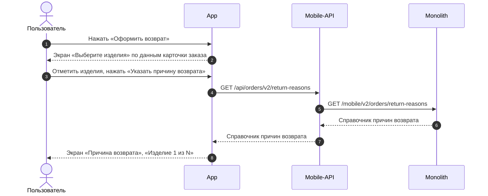

# SRS по шаблону

SRS описывает, что делает пользователь, что делает система и какие запросы при этом вызываются. Структура документа — [template.md](./template.md) (Markdown, по умолчанию) или [template-wiki.md](./template-wiki.md) (та же структура в разметке Яндекс Вики, п. 11). Готовый SRS — чистый документ для разработчиков: в нём нет рабочих пометок, рассуждений и инструкций.

## 1. Источники и их приоритет

1. **User story с критериями приёмки** — главный источник. Критерии приёмки не меняются и не пересказываются в формате Gherkin: каждый сценарий из них должен быть отражён шагом основной или альтернативной последовательности, веткой «Опционально», блоком «Ограничение» или «Правила и особенности сценария».
2. **BRD, ADR** — для контекста. Если они расходятся с user story, верна user story; расхождение сообщить аналитику (п. 9), в документ не писать.
3. **Ответы аналитика в переписке** — это решения. Они вносятся в документ по назначению информации:
   - действие или условие пользовательского процесса — в шаг сценария;
   - альтернативное поведение — в ветку «Опционально» или альтернативную последовательность;
   - функциональное ограничение — в «Ограничение»;
   - важный контекст и особенности процесса — в «Правила и особенности сценария» (п. 4);
   - проверки, расчёты и изменение серверной логики — в «Логику бэкенда» (п. 6.2).

   Сам разговор, дата ответа, кто ответил и что было до правки в документ не попадают. Исключение — раздел «Открытые вопросы» (п. 3.1).
4. Ничего не придумывать: поведение, тексты, поля, задачи, ссылки — только из источников.

## 2. Чья сторона описывается

- Сценарий пишется со стороны сайта / мобильного приложения и монолита.
- В **шагах сценария** показывается пользовательский уровень: пользователь выполняет действие → приложение или сайт вызывает метод API → приложение или сайт обрабатывает ответ и отображает результат. Внутренние операции бэкенда — проверки, расчёты, сохранение данных, обращения к другим сервисам (логистика, геосервис, Mindbox, RetailCRM, 1С) — отдельными шагами не описываются; где они описываются — п. 6.2. Шаг `Бэкенд` — только по правилу п. 5.
- **Исключение** — история, которая сама описывает взаимодействие сервисов (например, фоновый процесс: восстановление баллов, отправка опроса). Тогда обращения бэкенда к внешним системам пишутся в шагах, а у истории обязательно есть диаграмма взаимодействия (п. 6).
- В **диаграмме взаимодействия** эти обращения показываются обязательно (п. 6).
- В **диаграмме логики** — только развилки и действия, без вызовов между системами (п. 6.1).
- То, что происходит вне наших систем (клиент договаривается с транспортной компанией, работа сотрудников Дружбы в RetailCRM), не описывается.
- Что считает бэкенд, а что показывает клиент, — по `AGENTS.md` → «Принципы проектирования»: расчёты выполняет бэкенд, сайт и приложение показывают готовое значение из ответа метода.

## 3. Структура документа

Порядок разделов — как в `template.md`:

| Раздел | Когда добавлять |
|---|---|
| Полезные материалы | Всегда. Только реально существующие ссылки: макеты, user story, эпик, ТЗ, User Flow и т. п. |
| Открытые вопросы | Только если проект ведёт рабочие вопросы в SRS (п. 3.1). Сразу после «Полезных материалов» |
| Глоссарий | Если в документе есть термины, которые можно понять по-разному: «активная заявка», «дата получения заказа». Таблица «Термин — Определение», термины по алфавиту. Определение отвечает на вопрос «что это», без ссылок и без способа расчёта: расчёт — в шаге или в таблице «Логики бэкенда». Термин из глоссария в тексте используется только в этом значении. |
| Основные принципы | Только если есть правила, общие для нескольких user story. Нумерованный список, одно правило — одна строка. |
| Функциональные требования | Только если они явно даны для этого SRS. Формулировки «Система должна…», «Пользователь должен иметь возможность…». Из BRD ради заполнения не переносить. |
| Задачи после MVP | Внутри функциональных требований, только если разделение на MVP и Post-MVP зафиксировано. |
| User story | Основная часть. |

Раздел без данных не создаётся — ни заголовком, ни пустой таблицей, ни строкой «нет данных». Исключение — раздел «Задачи» (п. 7).

**Действующие документы.** Правила скилла не дают права перестраивать готовый SRS. В действующем документе сохраняются его сложившиеся разделы и названия (например, «Данные БД», «Не забыть про», «Примечание»), в том числе в новых историях, которые добавляются в этот документ. К шаблону документ приводится только по отдельному заданию.

### 3.1. Открытые вопросы

Раздел ведётся, только если проект решил держать рабочие вопросы в SRS. Проект определяет, в какой SRS он ведётся: например, в проекте returns-2.0 — только в SRS МП, в SRS сайта вопросы не дублируются.

- Место — сразу после «Полезных материалов». Вопросы сгруппированы по историям, внутри группы — нумерованный список. Оформление раздела в действующем документе сохраняется как есть.
- В разделе сохраняются исходные формулировки вопросов, частичные ответы, ответственные, источники ответов и ссылки. Это исключение из п. 8 только для этого раздела.
- Вопрос с частичным ответом остаётся открытым. Вопрос и ответ на него не превращаются в требование, пока аналитик не перенёс решение в сценарий, правила или «Логику бэкенда».
- При добавлении нового вопроса: если по теме есть файл в `requirements/questions/`, в разделе ставится ссылка на него, а не копия вопроса. Существующие вопросы, частичные ответы и ссылки сохраняются как есть, без автоматической замены или удаления.
- Перед записью нового вопроса проверяются доступный код и принятые решения. Код подтверждает только текущее поведение (AS-IS); согласованное целевое поведение (TO-BE) имеет приоритет над ним. Если код отвечает на вопрос о существующей реализации, такой вопрос не создаётся. Если поведение в коде отличается от целевого требования, расхождение показывается аналитику, а требование не заменяется. Код не основание закрывать существующие вопросы или менять целевую бизнес-логику.
- Вопросы по системам других команд остаются, если ответ нужен для сценария сайта или МП или для разработки.
- Существующие вопросы не удаляются, не переносятся, не объединяются и не переформулируются без поручения аналитика. Закрывает вопрос аналитик.

## 4. User story

- `## <Функциональная область>` — группа связанных историй: «Карточка заказа», «Оформление возврата», «Личный кабинет». Не повторяется перед каждой историей.
- `### <Название User Story> US <N>` — каждая история с собственной формулировкой «Как / Я хочу / Чтобы». Название — действие в инфинитиве: «Выбрать изделия для возврата», «Подтвердить создание возврата». Номер — из user story; части одной истории нумеруются через точку: US 1.1, US 1.2.
- Сразу под заголовком — формулировка одной строкой: «Как <роль>, я хочу <действие>, чтобы <ценность>».
- Далее по порядку: Дизайн → Сценарий (Предусловие, Основная последовательность, Альтернативные последовательности) → Ограничение → Правила и особенности сценария → Взаимодействие компонентов → Логика сценария → Логика бэкенда → Задачи.
- **Дизайн** — «Ссылка на Figma: <ссылка>», только если ссылка есть.
- **Предусловие** — нумерованный список состояний перед началом сценария: где находится пользователь, что уже выбрано. Только если есть.
- **Ограничение** и **Правила и особенности сценария** — под таблицами сценария, только если есть содержание.

  **Ограничение** — отдельный блок: установленные границы поведения и функциональные ограничения — что система намеренно не делает и почему.

  **Правила и особенности сценария** — важные правила, нюансы и контекст процесса, без которых разработчик и тестировщик могут понять сценарий неоднозначно и которые перегрузили бы таблицу шагов: откуда берутся данные и как они формируются, почему значение может отличаться, особенности внутренних процессов.
  - Допускается тематическая группировка подзаголовками курсивом: *Выбор города*, *Курьер*, *Даты и интервалы*. Нумерация пунктов сквозная.
  - Одно положение — одна мысль. Лимита длины нет; главное — однозначность, отсутствие повторов и удобство чтения.
  - То, что уже сказано в шаге или в «Основных принципах», не повторяется.
  - Название раздела. В новых SRS, которые создаются по шаблону, — «Правила и особенности сценария». В действующих SRS, где раздел называется «Примечание», название сохраняется, в том числе для новых историй этого документа.

  Оба блока пишутся по смыслу процесса: что происходит и почему. Не пишется: как это реализовано в коде, история решения, кто и когда решил, ссылки на ADR и BRD.

  | Хорошо | Плохо |
  |---|---|
  | Количество одинаковых изделий хранится в одной записи позиции заказа, и статус меняется сразу для всей записи. Поэтому после возврата части изделий позиция целиком недоступна для самостоятельного возврата. | По решению встречи 25.09 и ADR-RET-039 позиция блокируется, т. к. в таблице `order_items` поле `qty`… |
  | Список способов возврата для города задаётся настройкой по городу. Приложение показывает только способы из ответа метода и не проверяет город отдельно. | Уточнили с аналитиком 12.10: Почту России не хардкодим, Калининград не проверяем. |
  | Дата на экране предварительная. Окончательная считается как `created_at` + 10 календарных дней, поэтому может отличаться на день. | `SELECT created_at + INTERVAL '10 day' FROM returns` |
## 5. Основная последовательность

Таблица `Шаг | Исполнитель | Описание`.

- **Исполнитель** — кто отвечает за шаг:

  | Исполнитель | Кто это | Что делает в шаге |
  |---|---|---|
  | `Пользователь` | Клиент | Нажимает, вводит, выбирает |
  | `APP` | Мобильное приложение (iOS и Android), только в SRS МП. Пишется латиницей, чтобы колонка «Исполнитель» не сливалась с текстом в таблице | Отображает, проверяет заполнение полей на экране, вызывает метод, подставляет данные из ответа |
  | `Сайт` | Фронтенд сайта, только в SRS сайта | То же для сайта |
  | `Бэкенд` | Серверная часть канала целиком | Самостоятельное действие или значимая развилка сценария — только по правилу «Шаг `Бэкенд`» ниже |

  Кто внутри бэкенда выполняет операцию (шлюз, монолит, внутренний сервис), видно на sequence-диаграмме и в задачах; в шагах это не уточняется.
- **Граница шага.** Один шаг — одна логически завершённая операция одного исполнителя.
  - Обычная последовательность: пользователь выполняет действие → `APP` или `Сайт` вызывает метод → `APP` или `Сайт` обрабатывает ответ и отображает результат. Вызов метода и отображение результата — разные шаги.
  - Связанные действия одного исполнителя в рамках одной операции — в одном шаге: вызов метода, индикатор загрузки и блокировка повторного нажатия; отображение данных и обновление заголовка.
  - Отдельный шаг нужен, когда появляется новое действие пользователя или новый триггер, отдельный вызов метода, отдельный результат или переход, от которого зависит дальнейший путь.
  - Длина текста — повод проверить читаемость, а не основание дробить шаг.
  - Проверка: если действие перенести в соседний шаг или в «Логику бэкенда», изменится ли понимание последовательности и результата? Если нет — отдельный шаг не нужен.
- **Шаг `Бэкенд`** добавляется, только когда он нужен для понимания самостоятельного действия или значимой развилки сценария. Автоматически после каждого вызова метода он не добавляется. Проверки, расчёты, сохранение данных и обращения к другим сервисам внутри одного запроса отдельными шагами не описываются (п. 6.2).
- **Глаголы:**
  - пользователь — «Нажимает "Оформить возврат"», «Выбирает город»;
  - приложение или сайт — «Вызвать метод `GET /…` (`…`)», «Отобразить экран "…"», «Проверить заполнение …»;
  - бэкенд — «Вернуть …», «Рассчитать …», «Проверить …», «Сохранить …».
- **Запросы** — «Вызвать метод», затем HTTP-метод и после слэша действие по-русски. Русское название обязательно всегда. В скобках — фактический или предполагаемый путь; `TBD` в записи метода означает новый метод, который предстоит реализовать:

  | Случай | Запись |
  |---|---|
  | Метод есть и подходит | `GET /получить способы возврата для города` (`GET /api/v1/delivery/{order_id}/return-method-list`) |
  | Метод есть, но его нужно доработать | `GET /получить карточку заказа` (`GET /api/orders/{id}`) |
  | Метода нет, путь предполагаемый | `GET /получить магазины, принимающие возвраты` (`GET /api/v1/stores/returns`, TBD) |
  | Метода нет, пути нет | `POST /создать заявку на возврат` (TBD) |

  У существующего метода и у метода, который нужно доработать, `TBD` нет. У нового метода `TBD` есть всегда, даже если путь указан. Пути не придумываются. Пометки «новый метод» и «доработка метода» пишутся только в заголовке блока «Логики бэкенда» (п. 6.2). Если неизвестно, есть ли метод, вопрос уходит аналитику (п. 9). Правило `TBD` для методов не меняет правило `TBD` для полей (ниже). Запись методов на диаграмме — по скиллу `sequence-diagram`.
- **Несколько методов по условию.** Если метод зависит от условия (например, от способа возврата), допускается один смысловой шаг: «Получить данные выбранной точки. Метод зависит от способа:<br>— СДЭК, 5Post — `GET /…` (`…`);<br>— магазин — `GET /…` (`…`, TBD)».
- **Откуда данные для запроса.** Источник данных, нужный для понимания последовательности, указывается кратко по смыслу в самом шаге вызова: «Вызвать метод `GET /получить данные города` (`…`) по городу доставки из карточки заказа (US 1.1)». Полный набор параметров запроса не перечисляется. Как данные формируются, преобразуются и рассчитываются — в «Логике бэкенда» или в «Правилах и особенностях сценария». Отдельный шаг для получения данных — только если это самостоятельная операция, которая влияет на последовательность.
- **Названия полей и параметров** — только там, где поле нужно для понимания условия, выбора или результата: ветка, отображаемое значение, сопоставление данных. Контракт метода в шаге не расписывается. Используются только параметры и поля API, которые уже есть в существующих методах или согласованы в user story: `geo_id`, `return.is_bank_data_required`. Таблицы и колонки базы данных (`cms_users_user.is_vic`) не указываются — пишется смысл: «признак клиента F&F». Для новых методов описывается смысл данных: «вернуть признак, нужны ли банковские реквизиты».
  - **Новое поле нового или дорабатываемого метода** — сначала смысл, затем рабочее название в скобках с пометкой `TBD`: «сколько изделий позиции остаётся у клиента (`items[].remaining_quantity`, TBD)». Требование задаёт смысл; название — ориентир, итоговое фиксируется в задаче на бэк. Если в документе есть пометки `TBD`, в «Глоссарий» добавляется термин «TBD» с этим смыслом; строки-пояснения в блоках «Логики бэкенда» не пишутся. После релиза метода пометка `TBD` снимается, названия сверяются с фактическим контрактом.
  - **Ссылки между значениями.** Если формула, условие или ветка опирается на другое значение, рядом со смыслом указывается его поле (новое — с `TBD`): «если позицию можно вернуть (`items[].can_be_returned = true`), то равно количеству изделий, оставшихся у клиента (`items[].remaining_quantity`, TBD), иначе 0». Отсылка «из шага N» без поля не используется.
  - **Несколько связанных значений** (три и больше, ссылаются друг на друга или легко путаются) в ячейку шага не перечисляются. В шаге — только действие APP или Сайта по отображению готового результата и ссылка на таблицу: «Отобразить экран «Выберите изделия»: изделия, доступные к возврату, — по таблице „Данные позиции для возврата“ в разделе „Логика бэкенда“». В «Логике бэкенда» — таблица и пример по п. 6.2. Определения общих терминов (например, «активная заявка») — в разделе «Глоссарий».
  - **Ветки, которые следуют из основного условия**, не пишутся: если сообщение возвращается при `can_be_returned = true`, а признак уже учитывает срок, ветка «если срок истёк — не возвращать» не нужна.
- **Расчёты** — если шаг что-то считает, формула пишется через поля API и простые операции: «Дата — `created_at` + 10 календарных дней», «дата получения заказа + 14 дней». Поля — по правилу о названиях полей выше.
- **Ветки** — внутри ячейки того шага, где они возникают, после основного действия:

  ```
  **Опционально**
  1. Если <условие>, то <поведение>
  ```

  Слово «Опционально» выделяется жирным: `**Опционально**`. Ветки нумеруются всегда, даже если ветка одна. «Опционально» — условная ветка, обязательная к реализации при своём условии. Отдельный раздел для веток не создаётся.
- **Успех и ошибка.** Успешный и ошибочный результаты логически согласованы:
  - действие, которое выполняется только после успешного ответа, пишется с этим условием: «Скрыть индикатор загрузки. После успешного создания заявки закрыть экран «Оформление возврата»»;
  - ошибки, которые меняют интерфейс, описываются ветками в том шаге, где они возникают: «1. Если бэкенд вернул ошибку, то оставить экран открытым и сохранить введённые данные»;
  - одинаковое действие (снять индикатор загрузки) пишется один раз, а не в каждой ветке;
  - неизвестные варианты обработки ошибок не добавляются ради полноты; общее поведение при технической ошибке — один пункт в «Основных принципах».
- **Альтернативная последовательность "<Название>"** — отдельная таблица после основной, если ветка — это несколько собственных шагов пользователя и системы (сменить город, выбрать курьера, указать реквизиты). Короткая ветка из одного-двух действий остаётся в «Опционально». Нумерация шагов в каждой таблице своя. Для сложной альтернативной последовательности допускается отдельная sequence-диаграмма того же канала (п. 6).
- **Несколько простых действий на одном экране** допускается объединить в один шаг «Обработать действие пользователя на экране» с вариантами в «Опционально», если это упрощает чтение. Действие с собственной последовательностью из нескольких шагов — отдельная альтернативная последовательность. Границы историй и задач разработки задаёт команда: функциональность между историями не перераспределяется.
- **Подшаги** — 3.1, 3.2, только если действие действительно входит в действие родительского шага; не по количеству проверок, полей или технических операций. Самостоятельный шаг в конце группы получает следующий номер (7.4 после 7.3). Самостоятельный шаг между существующими требует перенумерации — только по решению аналитика, со сверкой всех ссылок на номера шагов.
- **Формулировки** — короткие, прямые, однозначные. Поведение описывается утвердительно, если смысл сохраняется: «При ошибке оставить экран открытым», а не «Не закрывать экран при ошибке». Реальные запреты, ограничения и тексты интерфейса сохраняют исходный смысл и утверждённые формулировки.
- **Ссылки в шагах** (включая «Опционально»):
  - разрешены ссылки на шаги процесса: «См. сценарий US 1.3», «(US 1.1)», «как на шаге 2 US 1.1», «шаги 8–10 повторяются»;
  - разрешены ссылки на таблицы этой же SRS: «по таблице «Проверка обязательных полей»», «по таблице «Данные позиции для возврата» в разделе «Логика бэкенда»»;
  - запрещены ссылки на другие документы: ADR, BRD, `FR-*`, `RULE-*`, `OQ-*`, транскрибации, разборы встреч, файлы `sources/`, другие SRS, markdown-ссылки на файлы. Обоснование решения — в ADR или в ответе аналитику (п. 9).
- **Тексты интерфейса** (кнопки, заголовки, сообщения об ошибках) — в двойных кавычках, точно как в user story или макете.

### 5.1. Сайт и МП

Сайт и мобильное приложение описываются отдельными SRS.

- Если действие, условие и ожидаемый результат одинаковые, текст шага в обеих SRS одинаковый.
- Допустимые отличия: исполнитель (`APP` / `Сайт`); элементы интерфейса (экран / страница / панель / шторка / модальное окно); методы API, пути и параметры; источники данных; техническая цепочка вызовов; действия, характерные для одной платформы; нумерация шагов. Одинаковая нумерация не требуется, фиктивные шаги для выравнивания не добавляются.
- Названия элементов интерфейса и подтверждённые различия берутся из проектных справочников, если они ведутся (в returns-2.0 — `requirements/ui/ui-terms.md` и реестр «Допустимые различия» сверки SRS сайта и МП).
- Реальные отличия платформ не устраняются ради формального совпадения документов.
- При сверке SRS сайта и МП в ответе аналитику — короткая таблица только подтверждённых функциональных различий: `Шаг или функция | Сайт | МП | Причина`. В SRS эта таблица не добавляется.
- Общая серверная логика двух каналов описывается один раз — в SRS, которую проект выбрал источником (п. 6.2).

## 6. Взаимодействие компонентов

- Sequence-диаграмма в Mermaid по скиллу `sequence-diagram`: участники, цепочки вызовов, стрелки, подписи, блоки `alt` / `opt`, ошибки.
- Диаграмма добавляется, если в истории есть хотя бы один запрос. Альтернативные последовательности — по скиллу `sequence-diagram`.
- **По каналам.** В SRS канала — диаграмма этого канала. Цепочка каждого канала строится отдельно по скиллу `sequence-diagram`, а не по аналогии с другим каналом.
- **Полная подтверждённая цепочка.** Диаграмма показывает полную подтверждённую цепочку канала по правилам скилла `sequence-diagram`, даже если в шагах её нет. Цепочка в таблицу шагов не переносится. Образец в шаблоне минимальный и не означает, что диаграмму можно сократить до точки входа.
- Обводка внутренней части цепочки блоком `box` — по желанию, не обязательна.

### 6.1. Логика сценария

- Flowchart в Mermaid по скиллу `flowchart-diagram`: содержание диаграммы, объединение проверок и соответствие сценарию по смыслу — по правилам этого скилла.
- Диаграмма добавляется, если в последовательности есть хотя бы одна ветка «Опционально» или переход в альтернативную последовательность. Одна диаграмма — на одну последовательность, с подписью — названием последовательности.
- Если для диаграммы нужна развилка, которой нет в сценарии (например, «Пункт указан в заказе?»), сначала дополняется таблица шагов.

### 6.2. Логика бэкенда

«Логика бэкенда» — место функциональных требований к серверной части: проверок, расчётов, сохранения данных, требований к интеграциям и обработке их результатов. Она описывает только новые методы и необходимые изменения существующих. Раздел добавляется в историю, только если в ней дорабатываются существующие методы или есть требования к новым методам.

- **Существующий метод** — только необходимые изменения. Текущее поведение (AS-IS) целиком не переписывается; упоминается, только если без него непонятна доработка («14 дней, как сейчас»).
- **Существующий метод без изменений** в раздел не включается: его AS-IS заново не описывается, подтверждённые технические вызовы остаются на sequence-диаграмме (п. 6).
- **Совместимость.** Если доработка может повлиять на текущих потребителей метода, фиксируется подтверждённое требование о сохранении существующего поведения: «для служб доставки заказов метод работает как сейчас».
- **Новый метод** — необходимая функциональная логика, подтверждённая источниками: условия, проверки, расчёты, результат и другие требования к методу.
- Внутренняя техническая реализация, код и проектирование хранения данных не придумываются — это решает разработка.

Для каждого нового или дорабатываемого метода — блок в одном порядке. Пункты 3–4 добавляются, только если для них есть содержание. Диаграмма логики отдельного метода не создаётся:

1. Заголовок: `**\`МЕТОД /действие по-русски\` (\`фактический метод\`) — доработка метода**` или для нового метода — запись по таблице «Запросы» п. 5 и `— новый метод`: `**\`POST /создать заявку на возврат\` (TBD) — новый метод**`.
2. Нумерованный список доработок или требований нового метода: один пункт — одно изменение или требование. Поле — в скобках, условие — в конце пункта, ссылка на историю, где значение используется, — в скобках: «Признак `return.is_bank_data_required` — `true` также при оплате подарочным сертификатом (US 1.5)». Связанные значения — одним пунктом со ссылкой на таблицу.
3. Таблица связанных значений, если они есть: `| Поле | Что означает | Как считается | Где используется |`. Одно поле — одна строка, базовые выше производных. Для существующего поля в «Как считается» — только то, что добавляется: «К текущим условиям добавляются:<br>1. …<br>2. …». Производное правило — через другие поля таблицы: «`can_be_returned = true` → равно `remaining_quantity`, иначе 0».
4. **Пример** — отдельной таблицей под основной: `| Поле | <Случай 1> | <Случай 2> |`, с общим условием в заголовке («**Пример:** в позиции 3 изделия»). Случаи подбираются так, чтобы в одном значения совпадали, а в другом расходились.
**Общая серверная логика двух каналов.** Если проект выбрал SRS-источник общей серверной логики (в returns-2.0 — SRS МП), логика описывается только в нём. В SRS другого канала блок метода содержит:

- собственный метод канала и пометку «новый метод» или «доработка метода»;
- подтверждённые отличия канала, при необходимости — соответствие своих полей полям источника;
- ссылку на общую логику с номером истории: «логика — SRS МП, US 1.5».

Общая логика не означает общий API: у каждого канала свой контракт и своя цепочка вызовов (п. 6). В других проектах источник общей логики определяется отдельно.

## 7. Задачи

- Таблица `| Название | Ссылка |` — только реально заведённые задачи этой истории.
- «Название» — суть задачи из трекера словами, без тегов `[B]`, `[Web]` и без ключа: «Доработать метод получения информации по заказу». «Ссылка» — адрес задачи в трекере: `https://tracker.yandex.ru/<KEY>`. Ключ в «Название» не пишется: в Вики обе колонки показывали бы одно и то же. Нет названия — спросить аналитика.
- Задач нет — раздел остаётся с пустой таблицей (только заголовок `| Название | Ссылка |`), чтобы не забыть завести задачу. Одна задача указывается в одной истории — там, где дорабатывается её метод или функциональность; в других историях она не повторяется.

## 8. Чего в документе быть не должно

**Код и техническая реализация**

- Фрагментов кода и псевдокода, условий в синтаксисе языка программирования (`if`, `&&`, `==`).
- SQL-запросов и их частей.
- JSON, тел запросов и ответов, схем данных. Состав данных описывается словами: «передать выбранные изделия и причину по каждому».
- Таблиц и колонок БД, классов, функций, файлов и путей в коде, очередей, форматов хранения.
- Названий веток, коммитов, задач разработки в тексте шагов (задачи — только в таблице «Задачи»).

Допустимый «технический» синтаксис в документе — запросы, поля API и формулы расчёта в формате п. 5 и Mermaid-диаграммы.

**Следы работы и переписки**

- Пометок процесса работы: «TODO», «на уточнении», «уточнение от 12.10», «перенесено из…», «в исходном варианте было…», «добавлено по ответу…», «исправлено», «новое».
- Ссылок на переписку и участников: «как обсудили», «по ответу аналитика», «подтвердила Катя», «по итогам встречи».
- Пересказа того, что было в предыдущей версии документа, и списка изменений.
- Вопросов, предположений и вариантов «если решат так, то…» — вне раздела «Открытые вопросы» (п. 3.1).
- Пояснений к шаблону, правил заполнения, комментариев о том, почему раздел пустой или удалён.
- Ссылок на ID требований BRD, ADR и открытых вопросов в тексте шагов.
- Обоснований решений в шагах («так как…», «по решению встречи…»). Причина пишется в блоке «Ограничение» или «Правила и особенности сценария».
- Копий критериев приёмки в формате Gherkin.

Исключение — раздел «Открытые вопросы» (п. 3.1): в нём сохраняются частичные ответы, ответственные, источники ответов и ссылки.

Если поведение в источниках не определено, шаг описывается по тому, что известно, а пробел уходит в раздел «Открытые вопросы», если проект его ведёт, иначе — в список вопросов аналитику (п. 9).

**Правка готового SRS.** Текст меняется на месте: новая формулировка просто заменяет старую. Пометки «изменено», зачёркивания, комментарии и история правок в документ не добавляются. Что поменялось — перечисляется в ответе аналитику. Правится только то, что входит в задание: новые правила скилла не дают права перестраивать документ (п. 3).

**Удаление или объединение шагов в действующем SRS** — только по отдельному согласованному заданию и в таком порядке:

1. Определить все требования, условия, расчёты, ограничения и результаты, которые содержит шаг.
2. Проверить, где каждый из этих элементов уже описан.
3. Если подтверждённое требование есть только в удаляемом шаге — сначала предложить его перенос в подходящий раздел: серверная функциональность — «Логика бэкенда» (п. 6.2), пользовательское поведение — шаги и ветки, особенности процесса — «Примечание» или «Правила и особенности сценария» (п. 4).
4. Проверить ссылки на номера шагов в таблицах, ветках и других историях. Диаграммы проверить по смысловому соответствию сценарию (скиллы `sequence-diagram` и `flowchart-diagram`).
5. Только после этого предлагать удаление или объединение шагов.

Sequence-диаграмма не считается самостоятельным местом хранения функциональных требований: она описывает взаимодействие компонентов.

## 9. Ответ аналитику (вне документа)

Вместе с SRS вернуть в ответе, а не в файле:

1. **Вопросы** — что не определено в источниках или встретилось как TODO. Если проект ведёт раздел «Открытые вопросы» (п. 3.1), новые вопросы предлагаются для этого раздела; существующие вопросы не меняются без поручения.
2. **Расхождения** — user story против BRD, ADR или макетов; текущее поведение в коде против целевого требования (п. 3.1).
3. **Покрытие** — каждый сценарий критериев приёмки и шаг или ветка SRS, где он отражён; отдельно — непокрытые.
4. **Различия сайта и МП** — при сверке двух SRS: таблица подтверждённых функциональных различий (п. 5.1).

## 10. Проверка перед сдачей

- [ ] Каждый сценарий критериев приёмки отражён в шаге, ветке «Опционально», блоке «Ограничение» или «Правила и особенности сценария».
- [ ] Ветки оформлены как `**Опционально**` и нумерованный список, даже если ветка одна.
- [ ] Исполнитель каждого шага — `Пользователь`, `APP` или `Сайт`, `Бэкенд`; в одной ячейке нет действий разных исполнителей.
- [ ] Каждый шаг — логически завершённая операция: нет отдельных шагов на индикатор загрузки, на каждое поле или проверку; независимые действия с собственной последовательностью не слиты в один шаг.
- [ ] Шаг `Бэкенд` есть только там, где он нужен для самостоятельного действия или значимой развилки; внутренние операции бэкенда — по п. 6.2.
- [ ] Обращения бэкенда к другим сервисам: последовательность технических вызовов — на диаграмме взаимодействия; подтверждённые функциональные требования к интеграциям и обработке их результатов — при необходимости в «Логике бэкенда» по п. 6.2; отдельных пользовательских шагов на каждый внутренний вызов нет. В шагах обращения пишутся, только если история сама описывает взаимодействие сервисов и у неё есть диаграмма взаимодействия.
- [ ] Успешный и ошибочный результаты согласованы: действие после успешного ответа записано с этим условием, ошибки — ветками того шага, где возникают.
- [ ] Источник данных для вызова указан кратко по смыслу; полного перечня параметров в шагах нет; поля — только для условия, выбора или результата.
- [ ] Диаграммы в Mermaid; в SRS канала — sequence этого канала с полной подтверждённой цепочкой, без маршрута, скопированного с другого канала.
- [ ] Sequence проверена по чек-листу `sequence-diagram`, диаграмма логики — по чек-листу `flowchart-diagram`; соответствие диаграмм сценарию — по смыслу, без привязки к номерам шагов.
- [ ] У каждого запроса есть русское название `МЕТОД /действие по-русски`, а в скобках — путь по таблице п. 5; `TBD` — у каждого нового метода и только у него; «новый метод» и «доработка метода» — только в заголовках «Логики бэкенда».
- [ ] При двух SRS одного процесса: совпадающие действия записаны одинаковым текстом, отличия — только допустимые (п. 5.1); общая серверная логика — в одной SRS-источнике, во второй — ссылка (п. 6.2).
- [ ] SRS МП: если поведение зависит от версии приложения, в «Ограничение» или «Правилах и особенностях сценария» записаны минимальная версия, что видит пользователь старой версии и когда отключается поддержка старого поведения (`skill/openapi-spec/references/backward-compatibility.md`, раздел 3); неизвестное — в «Открытые вопросы».
- [ ] Раздел «Открытые вопросы», если ведётся: на месте после «Полезных материалов», существующие вопросы и ответы не изменены (п. 3.1).
- [ ] Новые поля API записаны как «смысл (`поле`, TBD)»; в формулах и условиях у каждого упомянутого значения указано поле; существующие поля — без `TBD`.
- [ ] В шагах и «Опционально» ссылки только на шаги процесса и таблицы этой же SRS; ссылок на ADR, BRD, `FR-*`, `RULE-*`, `OQ-*`, источники, другие SRS и файлы нет.
- [ ] Глоссарий: только определения терминов — без ссылок и без способа расчёта; термины по алфавиту.
- [ ] «Логика бэкенда» — по п. 6.2: у существующего метода только изменения, у нового — подтверждённая функциональная логика; список; таблица связанных значений и пример отдельной таблицей — только при необходимости по п. 6.2; без диаграммы логики метода; в шаге — ссылка на таблицу. Нет веток «Опционально», которые следуют из основного условия.
- [ ] Нет разделов без данных и пустых таблиц, кроме раздела «Задачи»; одна задача — в одной истории.
- [ ] Нет кода, псевдокода, SQL, JSON, таблиц и колонок БД, имён классов и файлов (п. 8).
- [ ] Нет пометок процесса, следов переписки, вопросов и комментариев о правках (п. 8), кроме раздела «Открытые вопросы».
- [ ] «Ограничение» и «Правила и особенности сценария» («Примечание» в действующих SRS) написаны по смыслу процесса, без реализации и истории решения; пункты не повторяют шаги и «Основные принципы».
- [ ] Сложившиеся разделы и названия действующего документа сохранены; документ не перестроен сверх задания. Удаление или объединение шагов — по п. 8: требования шага сохранены в другом разделе до удаления.
- [ ] Заголовки историй — `<Название> US <N>`; формулировка «Как / Я хочу / Чтобы» под каждым.
- [ ] Таблицы корректно отображаются в Markdown: в каждой строке одинаковое число ячеек, переносы внутри ячейки — `<br>`.

## Пример

История из SRS возвратов для мобильного приложения, оформленная по всем правилам скилла: русские названия методов с фактическим методом в скобках, нумерованные ветки «Опционально» в ячейках, без отдельных шагов `Бэкенд` (справочник причин отдаётся как есть), блок «Ограничение», sequence-диаграмма с цепочкой канала МП.

### Выбрать изделия и причины возврата US 1.2

Как клиент, оформляющий возврат, я хочу выбрать одно или несколько изделий из заказа и указать причину возврата для каждого выбранного изделия, чтобы сформировать возврат только для тех изделий, которые я хочу вернуть

### Дизайн

Макеты: [v2 Создание возврата](<../../sources/mockups/v2 Создание возврата/>)

### Сценарий

#### Предусловие

1. В карточке заказа отображается кнопка «Оформить возврат» (US 1.1)

#### Основная последовательность "Выбрать изделия и причины возврата"

| Шаг | Исполнитель | Описание |
|---|---|---|
| 1 | Пользователь | Нажимает «Оформить возврат» |
| 2 | APP | Отобразить экран «Выберите изделия» по данным карточки заказа:<br>— только позиции без заявок на возврат или с заявкой в статусе «Возврат отменён»;<br>— позицию с количеством 2 и больше — поштучно, каждое изделие отдельной строкой;<br>— кофр или подарок, если он отдельная позиция заказа, — отдельной строкой;<br>— предупреждение о необходимости вернуть изделия в полной комплектации<br><br>**Опционально**<br>1. Если хотя бы на одно изделие позиции уже оформлена активная заявка на возврат, то все изделия этой позиции не отображать |
| 3 | Пользователь | Отмечает чекбоксами изделия |
| 4 | APP | Изменить заголовок экрана на «Выберите изделия · N» и сделать кнопку «Указать причину возврата» активной. Кофр или подарок при выборе основного изделия автоматически не отмечать<br><br>**Опционально**<br>1. Если не выбрано ни одного изделия, то кнопка «Указать причину возврата» неактивна |
| 5 | Пользователь | Нажимает «Указать причину возврата» |
| 6 | APP | Вызвать метод `GET /получить справочник причин возврата` (`GET /api/orders/v2/return-reasons`) |
| 7 | APP | Отобразить экран «Причина возврата» с подзаголовком «Изделие 1 из N» |
| 8 | Пользователь | Выбирает группу причин в выпадающем списке |
| 9 | APP | Отобразить список причин выбранной группы |
| 10 | Пользователь | Выбирает причину |
| 11 | APP | Перейти к следующему выбранному изделию. Шаги 8–10 повторяются для каждого выбранного изделия |
| 12 | APP | После выбора причины для последнего изделия сделать кнопку «Выбрать способ возврата» активной<br><br>**Опционально**<br>1. Если причина указана не для всех выбранных изделий, то кнопка «Выбрать способ возврата» неактивна<br>2. Если пользователь вернулся к экрану «Выберите изделия» с экрана причин или с экрана оформления возврата и изменил состав изделий, то причины указываются заново для каждого выбранного изделия, начиная с шага 5 |

**Ограничение**

Количество одинаковых изделий хранится в одной записи позиции заказа, и статус меняется сразу для всей записи. Поэтому после оформления возврата части изделий одной позиции вся позиция становится недоступна для самостоятельного возврата в приложении. Чтобы вернуть остальные изделия этой позиции, клиент обращается в отдел Дружбы.

### Взаимодействие компонентов



### Задачи

| Название | Ссылка |
|---|---|
| Доработать метод получения информации по заказу | https://tracker.yandex.ru/ECOMDEV-2343 |

## 11. Версия для Яндекс Вики

Если просят SRS для Яндекс Вики — заполнять [template-wiki.md](./template-wiki.md) или перевести готовый Markdown-документ. Содержание и порядок разделов те же, меняется только разметка:

| Элемент | Markdown (`template.md`) | Яндекс Вики (`template-wiki.md`) |
|---|---|---|
| Таблица | `\| a \| b \|` и строка `\|---\|` | `#\|` … `\|#`, строка — `\|\| a \| b \|\|`, заголовки ячеек жирным |
| Перенос строки внутри ячейки | `<br>` | обычный перенос строки внутри `\|\| … \|\|` |
| User story | строка «Как …, я хочу …, чтобы …» под заголовком | всё содержимое истории внутри `` … `` |
| Перечисление внутри ячейки | `<br>— пункт;` | пустая строка перед списком, пункты `* пункт` — без `;` и точки в конце |
| Ветка «Опционально» | `<br><br>**Опционально**<br>1. Если …` в ячейке | `**Опционально**` отдельной строкой внутри `\|\| … \|\|`, под ним `1. Если …` с новой строки |
| Ограничение | `**Ограничение**` и текст | `` … `` |
| Правила и особенности сценария | `**Правила и особенности сценария**` и текст | `` … `` |
| Примечание (в действующих SRS) | `**Примечание**` и текст | `` … `` |
| Открытые вопросы (п. 3.1) | раздел с вопросами и ссылками | тот же текст вопросов и ответов; ссылки на ADR, транскрибации, разборы встреч и `sources/` убираются (`AGENTS.md` → «Конвенция имён файлов») |
| Ссылка на SRS-источник общей логики (п. 6.2) | markdown-ссылка на файл допустима | текстом, без ссылки на файл: «логика — SRS МП, US 1.5» |
| Задачи после MVP | `**Задачи после MVP**` и список | `` … `` |
| Диаграмма (sequence и логика) | ` ```mermaid ` | ` ```mermaid ` без изменений, но внутри ката: sequence — ``, пустая строка, блок mermaid, сразу ``; диаграмма логики — ``, пустая строка, блок mermaid, `&nbsp;`, пустая строка, ``. Подпись последовательности — над катом |

Заголовок `### <Название User Story> US <N>` стоит над ``, а не внутри.
