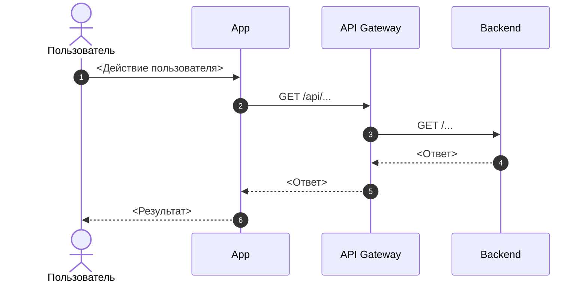
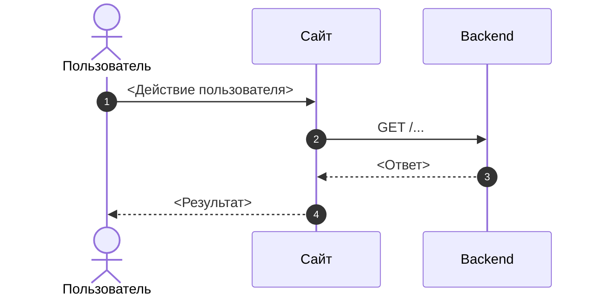
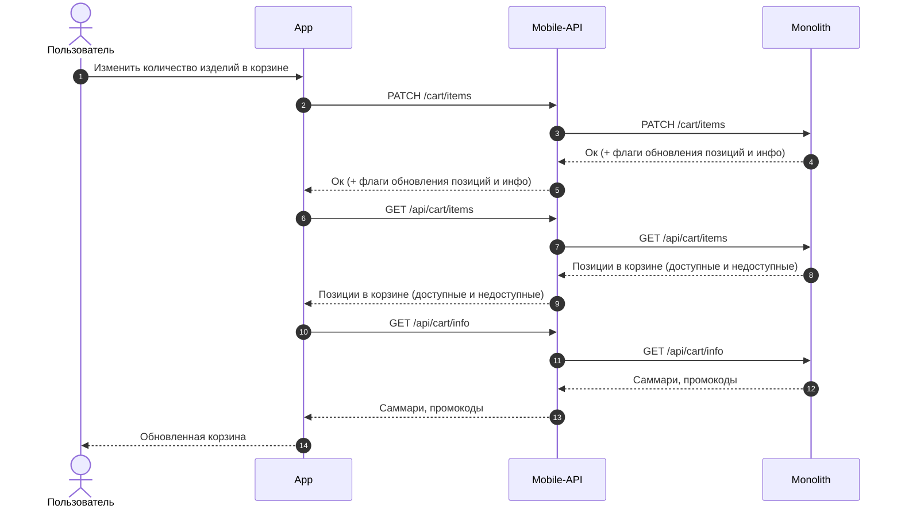

# SRS — шаблон

> Шаблон построен по структуре двух фактически используемых SRS. Цель — кратко и однозначно зафиксировать пользовательский сценарий, поведение системы, используемые API, взаимодействие компонентов и связанные задачи без дублирования BRD.

---

## Полезные материалы

> **Обязательный раздел.** Заполняется в начале SRS, чтобы все ключевые источники были доступны из одной точки.

| Название | Ссылка |
|---|---|
| `<Тип материала>` | `<URL>` |

**Примечание:** в таблицу добавляются только фактически существующие и релевантные для данного SRS материалы. В колонке «Название» указывается тип материала, например: `Макеты`, `User Flow`, `BRD / ТЗ`, `Epic`, `API-документация`, `ADR / решения`, `Другие материалы`. Не нужно создавать строки для материалов, которых нет или которые не используются в рамках данной функциональности. Пустые или фиктивные строки не создаются.

---

## Основные принципы

> Раздел заполняется только в том случае, если для всей функциональности существуют общие правила, которые относятся сразу к нескольким User Story.

1. `<Общий принцип / правило>`
2. `<Общий принцип / правило>`

---

## Функциональные требования

> Раздел заполняется только в том случае, если функциональные требования действительно зафиксированы в рамках данного SRS. Не нужно переносить сюда требования из BRD только ради заполнения шаблона.

### `<Функциональный блок>`

1. <Функциональное требование>
2. <Функциональное требование>

**Разделение MVP / Post-MVP**

> Заполняется только в том случае, если для данной функциональности действительно зафиксировано разделение на MVP и Post-MVP. Если такого разделения нет, блок удаляется.

**В MVP:**
- `<...>`

**Post-MVP:**
- `<...>`

---

# User Story

## `<Название функциональной области>`

Группирующий раздел для связанных User Story. Например: Корзина, Оформление заказа, Авторизация, Просмотр бронирований. Это не название User Story и не обязательно название отдельного экрана. В одной функциональной области может быть несколько User Story.

Например
```
## Корзина

### US 1. Посмотреть состав корзины

### US 2. Добавить товар в корзину

### US 3. Изменить количество товара

### US 4. Удалить товар
```

### US `<N>`. `<Название User Story>`

> Как `<роль>`, я хочу `<действие / возможность>`, чтобы `<ценность / результат>`.

### Дизайн

Ссылка на Figma: `<URL>`

> Раздел заполняется только при наличии макетов для данной User Story.

### Сценарий

#### Предусловия

1. `<Предусловие>`
2. `<Предусловие>`

> Если специальных предусловий нет, раздел можно не добавлять.

#### Основная последовательность «<Название User Story>»

| Шаг | Исполнитель | Описание |
|---:|---|---|
| 1 | Пользователь | `<Действие пользователя>` |
| 2 | Система | `<Действие системы>` |
| 3 | Система | Получает `<данные>` (`GET /api/...`) |
| 4 | Система | `<Отображает / сохраняет / изменяет результат>` |

**Правило описания API:** если в шаге выполняется API-вызов, необходимо указывать смысловое действие и фактический HTTP-метод / endpoint в скобках.

Пример:

`Система получает список бронирований (GET /api/v1/reservation).`

Не использовать условные обозначения вида `GET /Получить данные`, если фактический endpoint уже известен.

Если точный endpoint ещё не определён, допускается указать `TBD`.

##### Опционально

1. Если `<условие>`, то `<поведение системы>`.
2. Если `<условие ошибки>`, то `<поведение системы>`.

> Альтернативные и ошибочные ветки можно фиксировать внутри основной последовательности через блок `Опционально`, если отдельный сценарий для них не требуется.

### Взаимодействие компонентов

> Раздел заполняется, если в рамках User Story есть взаимодействие нескольких систем / компонентов.

**Для мобильного приложения**


**Для сайта**



**Правила:**
- использовать фактические названия задействованных компонентов;
- указывать реальные HTTP-методы и endpoint'ы, если они известны;
- не добавлять компоненты, которые не участвуют в сценарии;
- если точный метод ещё не определён, использовать `TBD`.

### Задачи

> **Обязательный раздел для каждой User Story.** Таблица присутствует всегда, даже если связанные задачи на момент подготовки SRS ещё не заведены.

| Название | Ссылка |
|---|---|

**Примечание:** в таблицу добавляются только фактически существующие задачи, относящиеся к данной User Story. Если задачи ещё не заведены, таблица остаётся пустой до их появления. Не нужно создавать фиктивные задачи или строки для `Backend`, `API Gateway`, `Mobile`, `Web` и других компонентов только для заполнения таблицы.

---

# Дополнительные User Story

> Для каждой следующей User Story в рамках той же функциональной области повторяется блок от заголовка User Story до таблицы `Задачи`. Заголовок функциональной области повторно не создаётся. Новая функциональная область добавляется только при переходе к другой группе связанных User Story.

```text
### US <N>. <Название User Story>

Как <роль>, я хочу <действие>, чтобы <ценность>.

### Дизайн
<если есть>

### Сценарий

#### Предусловия
<если есть>

#### Основная последовательность «<Название User Story>»

| Шаг | Исполнитель | Описание |
|---:|---|---|
| 1 | ... | ... |

Опционально:
- ...

### Взаимодействие компонентов
<если требуется>

### Задачи

| Название | Ссылка |
|---|---|
```

Если следующая User Story относится уже к другой группе функциональности, сначала создаётся новый группирующий заголовок:

```text
## <Название функциональной области>
```

---

# Краткие правила заполнения

1. Не дублировать в SRS информацию из BRD без необходимости.
2. Описывать конкретный пользовательский сценарий и поведение системы.
3. Если система вызывает API, указывать фактический `HTTP method + endpoint` в скобках после смыслового описания действия.
4. Не придумывать API, задачи, компоненты, материалы или требования только ради заполнения шаблона.
5. Неиспользуемые необязательные разделы удалять.
6. В `Полезные материалы` указывать только реально существующие источники.
7. В `Задачи` указывать только реально заведённые задачи, относящиеся к конкретной User Story.
8. В sequence diagram показывать только фактически участвующие компоненты.
9. Если точные технические данные ещё не определены, использовать `TBD`, а не выдумывать значение.
10. Заголовок каждой User Story оформлять в формате `US <N>. <Название User Story>`.
11. Заголовок функциональной области используется для группировки связанных User Story и не повторяется перед каждой историей.
12. Таблица `Задачи` присутствует в каждой User Story всегда; если задач ещё нет, она остаётся пустой.

---

# Пример заполнения

> Пример взят из существующего SRS без перефразирования логики и формулировок сценария.  
> Для условных названий методов вида `GET /Получить ...` добавлены примерные endpoint'ы, чтобы показать требуемый формат записи API в шаблоне.

## Корзина

### US 3. Изменить количество товара

**Как** Пользователь, **я хочу** изменить количество товара в корзине, **чтобы** оформить необходимый мне заказ

### Дизайн

Ссылка на Figma: `https://www.figma.com/design/IYUsQtKgWNldFokDgTArkn/📱-05.-Cart-(Redesign)?node-id=4726-93776&t=0zyLwr3UFN2bPVjC-0`

### Сценарий

#### Предусловие

1. Пользователь находится в корзине

#### Основная последовательность «Изменить количество товара»

| Шаг | Исполнитель | Описание |
|---:|---|---|
| 1 | Пользователь | Нажимает "+" или "-" у добавленного в корзину товара |
| 2 | Система | Вызвать метод изменения количества товара (`PATCH /cart/items`) |
| 3 | Система | **Опционально:** Если вернулась ошибка, что нельзя добавить товар, т.к. нет остатков, то отображает ошибку; блокирует кнопку увеличения позиции |
| 4 | Система | Получили флаг обновления части корзины в ответе `PATCH /cart/items`. Вызвать метод получения позиций в корзине (`GET /api/cart/items`) |
| 5 | Система | Получили флаг обновления части корзины в ответе `PATCH /cart/items`. Вызвать метод получения информации по корзине (`GET /api/cart/info`) |
| 6 | Система | Отображает список всех добавленных товаров в корзину, в т.ч. доступные и недоступные |

### Взаимодействие компонентов



### Задачи

| Название | Ссылка |
|---|---|
| NOVADEV-6862 | https://tracker.yandex.ru/NOVADEV-6862 |
| NOVADEV-6863 | https://tracker.yandex.ru/NOVADEV-6863 |
| NOVADEV-6860 | https://tracker.yandex.ru/NOVADEV-6860 |
| NOVADEV-6861 | https://tracker.yandex.ru/NOVADEV-6861 |
| NOVADEV-6864 | https://tracker.yandex.ru/NOVADEV-6864 |
| NOVADEV-6865 | https://tracker.yandex.ru/NOVADEV-6865 |

> В исходном SRS для этого сценария в таблице задач были указаны только ссылки без названий задач. Поэтому в примере в колонке «Название» используется ID задачи, а не придуманное название.

