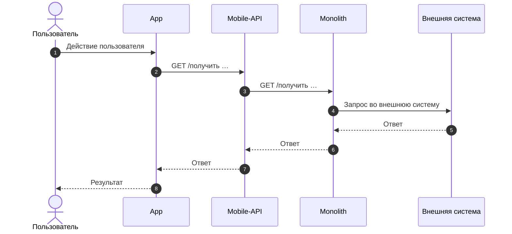
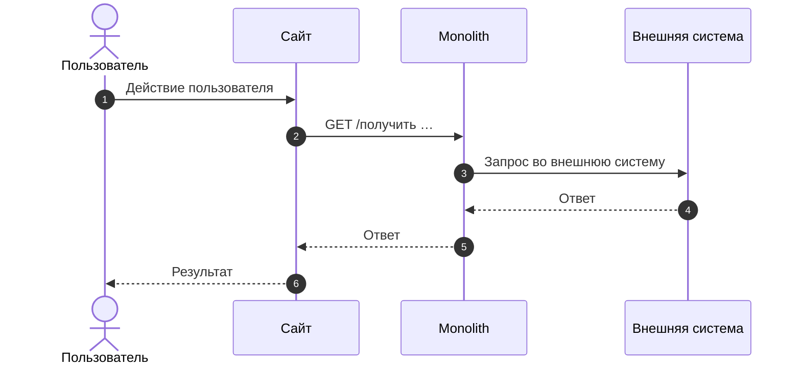

## Полезные материалы

| Название | Ссылка |
|---|---|
| Макеты | <ссылка> |
| User Story | <ссылка> |
| Эпик | <ссылка> |

## Основные принципы

1. <Принцип>

## Функциональные требования

### <Функциональный блок>

1. Система должна <действие>.
2. Пользователь должен иметь возможность <действие>.

**Задачи после MVP**

1. <Задача>

# User story

## <Функциональная область>

### <Название User Story> US <N>

Как <роль>, я хочу <действие>, чтобы <ценность>

### Дизайн

Ссылка на Figma: <ссылка>

### Сценарий

#### Предусловие

1. <Предусловие>

#### Основная последовательность "<Название User Story>"

| Шаг | Исполнитель | Описание |
|---|---|---|
| 1 | Пользователь | <Действие пользователя> |
| 2 | Система | Вызвать метод <назначение> `GET /<получить …>` |
| 3 | Система | Отобразить <результат>  Опционально Если <условие>, то <поведение> |

**Примечание**

<Текст примечания>

### Взаимодействие компонентов

**Мобильное приложение**

**Сайт**

### Задачи

| Название | Ссылка |
|---|---|
| <Название задачи> | <ссылка> |
