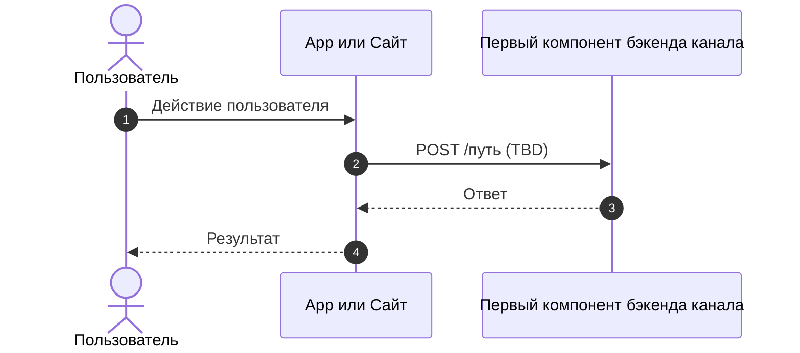
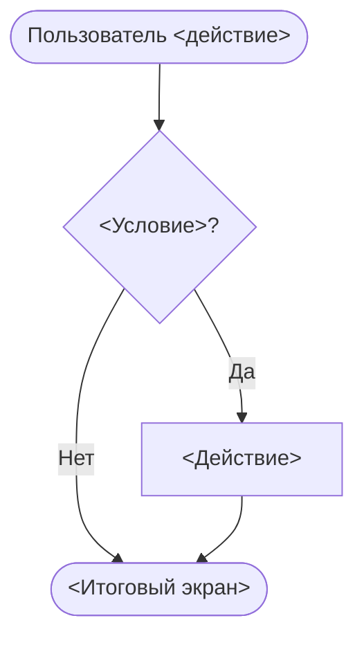

## Полезные материалы

| Название | Ссылка |
|---|---|
| Макеты | <ссылка> |
| User Story | <ссылка> |
| Эпик | <ссылка> |

## Глоссарий

| Термин | Определение |
|---|---|
| <Термин> | <Что это — без ссылок и без способа расчёта> |
| TBD (to be defined — «будет определено») | У метода API — новый метод, который предстоит реализовать. У поля API — предварительное название: итоговое определяет разработка в задаче на бэкенд, требование задаёт смысл значения |

## Основные принципы

1. <Принцип>

## Функциональные требования

### <Функциональный блок>

1. Система должна <действие>.
2. Пользователь должен иметь возможность <действие>.

**Задачи после MVP**

1. <Задача>

# User story

## <Функциональная область>

### <Название User Story> US <N>

Как <роль>, я хочу <действие>, чтобы <ценность>

### Дизайн

Ссылка на Figma: <ссылка>

### Сценарий

#### Предусловие

1. <Предусловие>

#### Основная последовательность "<Название User Story>"

| Шаг | Исполнитель | Описание |
|---|---|---|
| 1 | Пользователь | <Действие пользователя> |
| 2 | <APP или Сайт> | Вызвать метод `POST /<действие по-русски>` (`POST /<путь>`, TBD) по <источник данных по смыслу>. На время запроса отобразить индикатор загрузки на кнопке «<Кнопка>», повторное нажатие недоступно |
| 3 | <APP или Сайт> | Скрыть индикатор загрузки. После успешного ответа отобразить <результат>  **Опционально** 1. Если бэкенд вернул ошибку, то <поведение> |

**Ограничение**

<Что система намеренно не делает и почему>

**Правила и особенности сценария**

*<Тема>*

1. <Правило или особенность процесса>

### Взаимодействие компонентов

**<Мобильное приложение или Сайт>**

### Логика сценария

**Основная последовательность "<Название User Story>"**

### Логика бэкенда

**`GET /<действие по-русски>` (`GET /<путь>`) — доработка метода**

1. <Что добавить или изменить> (`<поле>`, TBD) — <условие> (US <N>)
2. <Связанные значения> — по таблице «<Название таблицы>»

**<Название таблицы>**

| Поле | Что означает | Как считается | Где используется |
|---|---|---|---|
| `<поле>` | <Смысл> | К текущим условиям добавляются: 1. <Условие> | <Экран или блок> |
| `<поле>`, TBD | <Смысл> | <Правило через другие поля таблицы> | <Экран или блок> |

**Пример:** <общее условие>

| Поле | <Случай 1> | <Случай 2> |
|---|---|---|
| `<поле>` | <значение> | <значение> |

**`POST /<действие по-русски>` (`POST /<путь>`, TBD) — новый метод**

1. <Требование к методу: условие, проверка, расчёт или результат>

### Задачи

| Название | Ссылка |
|---|---|
| <Название задачи> | <ссылка> |
